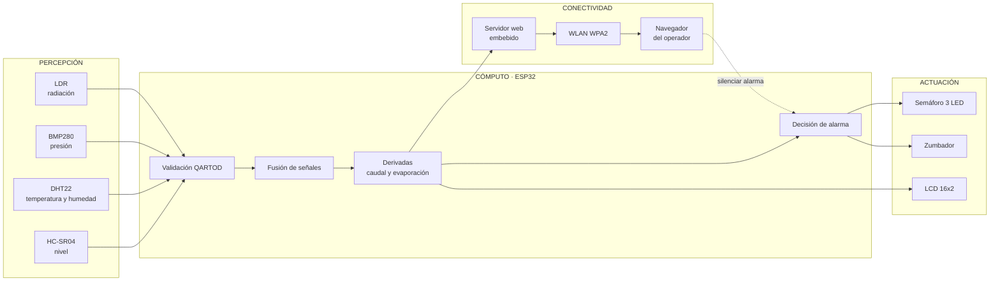
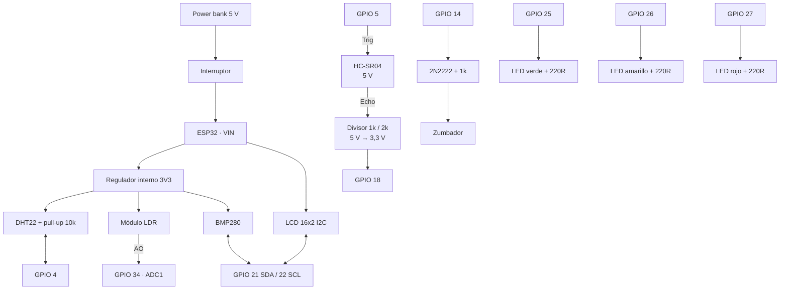
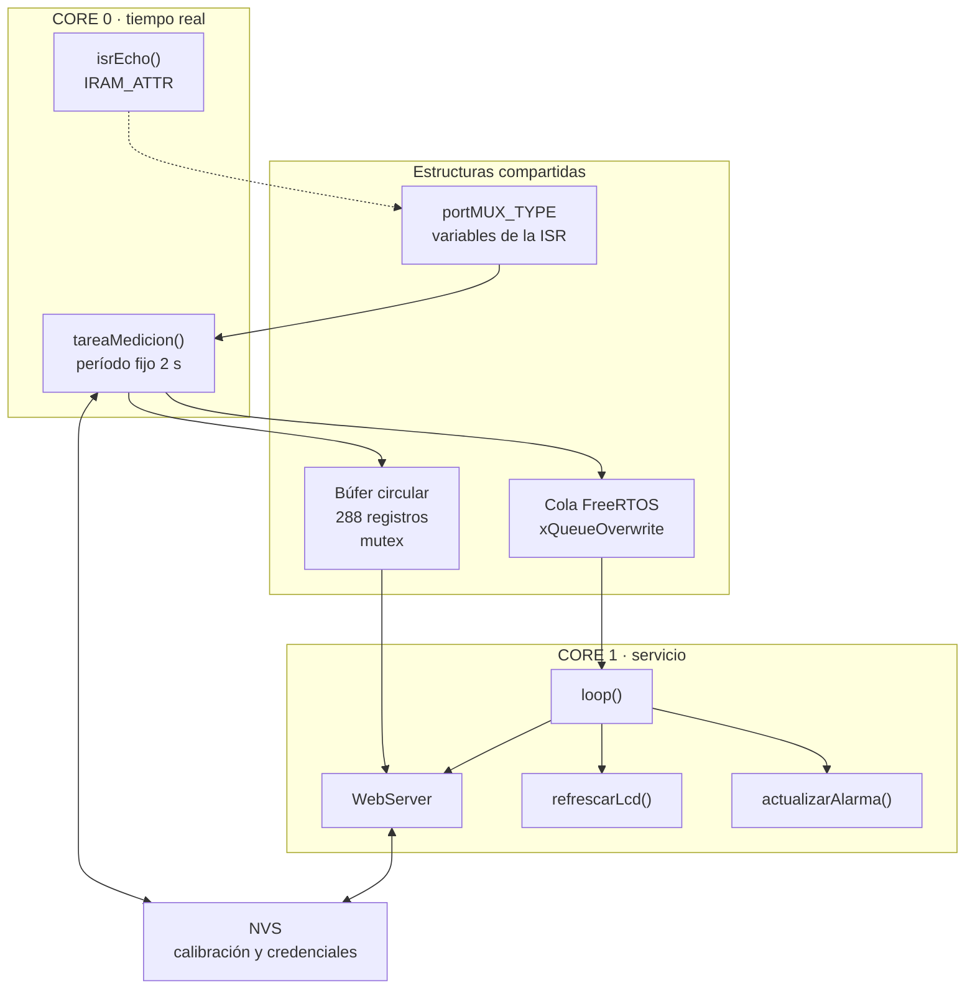
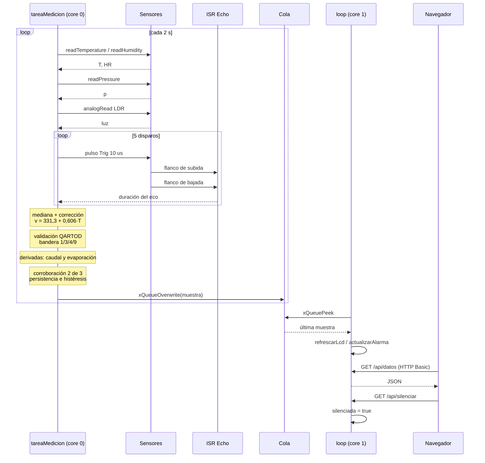
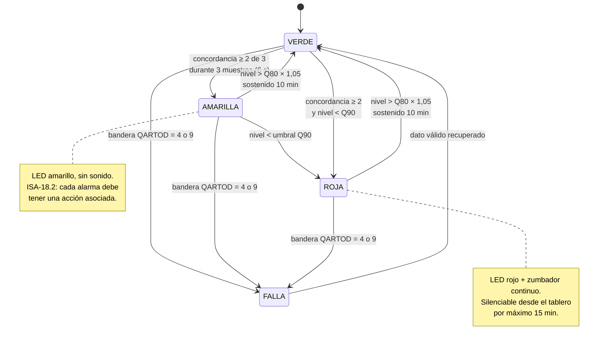

# 3. Arquitectura

## 3.1 Las tres capas del ecosistema IoT

La flecha punteada de retorno es importante: el tablero no solo observa, **actúa** sobre la alarma física. Es el requisito de desactivación remota del enunciado.

## 3.2 Diagrama de bloques de hardware

### Mapa de pines

| Señal | GPIO | Alimentación | Nota de diseño |
|---|---|---|---|
| HC-SR04 Trig | 5 | VIN (5 V) | — |
| HC-SR04 Echo | 18 | — | **Divisor obligatorio** 5 V → 3,3 V |
| DHT22 Data | 4 | 3,3 V | Pull-up 10 kΩ a 3,3 V |
| LDR (AO) | 34 | 3,3 V | **ADC1 obligatorio** |
| BMP280 SDA/SCL | 21 / 22 | 3,3 V | Bus compartido, dir. 0x76 |
| LCD SDA/SCL | 21 / 22 | VIN (5 V) | Bus compartido, dir. 0x27 |
| Zumbador | 14 | 5 V | Por transistor, diodo en paralelo |
| LED verde / amarillo / rojo | 25 / 26 / 27 | — | Resistencia 220 Ω |

> **Dos decisiones de diseño que no son evidentes.** El LDR va obligatoriamente en un canal **ADC1** (GPIO 32–39): el ADC2 del ESP32 queda inutilizable cuando el radio Wi-Fi está activo, y el tablero exige Wi-Fi permanente. Y el pin Echo entrega 5 V contra una entrada que tolera 3,3 V, de modo que el divisor resistivo no es una precaución sino un requisito para no destruir la placa.

## 3.3 Arquitectura de software

### Reparto de responsabilidades

| Núcleo | Tarea | Por qué ahí |
|---|---|---|
| **0** | Medición, validación, fusión, decisión | Período estricto de 2 s que no debe depender de peticiones web |
| **0** | ISR del Echo | Captura de flancos: exige latencia mínima y `IRAM_ATTR` |
| **1** | Servidor web | Puede bloquearse durante una petición sin afectar la medición |
| **1** | LCD y semáforo | Visualización y actuación, sin requisitos de tiempo estrictos |

## 3.4 Diagrama de secuencia de un ciclo de medición

## 3.5 Máquina de estados de la alarma

El retardo de activación (6 s) y el deadband de salida (5 % sostenido 10 min) son asimétricos a propósito: entrar en alarma debe ser rápido pero no impulsivo; salir debe exigir confirmación sostenida. Ambos valores siguen las recomendaciones de ISA-18.2 y EEMUA 191 y se justifican en detalle en §5.

## 3.6 Rutas del servidor web

| Ruta | Método | Función | Autenticación |
|---|---|---|---|
| `/` | GET | Página del tablero (PROGMEM) | HTTP Basic |
| `/api/datos` | GET | Valor actual de las 7 variables + estado | HTTP Basic |
| `/api/historico` | GET | 288 registros de 24 h en JSON | HTTP Basic |
| `/api/calibrar` | GET | Ajuste de altura y umbrales sin recompilar | HTTP Basic |
| `/api/silenciar` | GET | **Desactivación de la alarma física** | HTTP Basic |

El histórico se envía con `CONTENT_LENGTH_UNKNOWN` y `sendContent` por tramos, de modo que nunca se construye en memoria un JSON de 288 registros completo.
