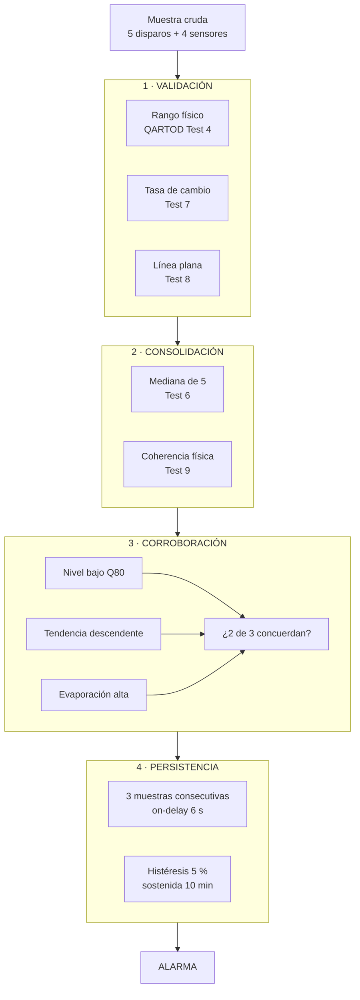

# 5. Lógica de fusión y umbrales de alerta

Esta sección responde por anticipado la pregunta que todo jurado hace: **¿por qué ese número y no otro?**

Ningún parámetro se escogió a ojo. Cada uno proviene de una de cuatro fuentes:

| Fuente | Qué aporta |
|---|---|
| **A · Hoja de datos** | Límites que impone el hardware. No son elegibles |
| **B · Geometría del montaje** | Lo que la física del banco permite que ocurra |
| **C · Rango normativo** | La norma da el rango; el montaje decide dónde caer dentro de él |
| **D · Consistencia interna** | El valor se amarra a otro parámetro ya fijado |

---

## 5.1 La cadena de decisión, en cuatro etapas



---

## 5.2 Una precisión conceptual: no es votación por mayoría

La regla "2 de 3" podría confundirse con *votación M-of-N*, una técnica de tolerancia a fallos donde **tres sensores redundantes miden la misma magnitud** y se descarta al disidente, como en la redundancia modular triple.

**Aquí no es eso.** Los tres indicadores —nivel bajo, tendencia descendente, evaporación alta— miden cosas distintas. No hay mayoría que establecer porque no existe una verdad única sobre la cual estén votando.

Lo que se implementa es **corroboración multivariable**, que corresponde al **Test 9 (Multi-Variate)** de QARTOD [5]: usar la coherencia entre variables independientes para decidir si una condición es real. El propósito no es tolerar fallos de sensores sino **reducir falsos positivos mediante evidencia concurrente**.

---

## 5.3 Justificación parámetro por parámetro

### Período de muestreo = 2 s · Fuente A

El DHT22 no admite lecturas a menos de 2 segundos. No es una decisión del equipo: es el límite del sensor más lento del conjunto y marca el reloj de todo el sistema.

### Mediana de 5 disparos · Fuentes A + D

Tres restricciones se cruzan y dejan un solo valor razonable:

- Debe ser **impar**, o no hay mediana.
- Una mediana de *N* tolera hasta *(N−1)/2* valores atípicos. Con 3 tolera 1; con 5 tolera **2**. Un eco falso por muestra es común con superficie ondulada; dos seguidos ya es raro.
- **Presupuesto de tiempo:** 5 × 60 ms = 300 ms, el 15 % del ciclo de 2 s. Con 7 disparos serían 420 ms y quedaría poco margen para los demás sensores y el refresco del LCD.

### Rango válido: 0 a 35 cm · Fuente B

No es una elección, es aritmética del montaje:

```
Altura del sensor sobre el fondo         40,0 cm
Distancia mínima medible (HC-SR04)      − 2,0 cm
──────────────────────────────────────────────
Nivel máximo físicamente medible         38,0 cm
Margen de seguridad                     − 3,0 cm
──────────────────────────────────────────────
Límite superior del filtro               35,0 cm
```

El límite inferior es 0 porque un nivel negativo no existe.

### Filtro de tasa = 3 cm entre muestras · Fuente B

Se calcula el cambio **más rápido físicamente posible** en 2 segundos y se deja margen sobre él:

```
Área de la lámina de agua (30 × 20 cm)      600 cm²
Caudal máximo de la válvula                2000 cm³/min
Velocidad máxima de descenso               3,33 cm/min
Cambio máximo en 2 s                       0,11 cm
```

El umbral de 3 cm es **27 veces el cambio real más rápido posible**. Un salto mayor no puede ser agua moviéndose: es un eco falso. Marcarlo como sospechoso no descarta ningún dato válido.

### Lectura congelada = 30 muestras con dispersión nula · Fuentes A + B

El razonamiento aquí es sutil y merece explicitarse, porque la objeción inmediata es "si el agua casi no se mueve, el sensor va a repetir lecturas".

La clave está en que un HC-SR04 sano **nunca entrega lecturas exactamente idénticas**: su ruido de medición supera su resolución, de modo que incluso con el agua perfectamente quieta los cinco disparos de una muestra difieren entre sí.

Por eso el firmware no vigila si el *nivel* cambia, sino si la **dispersión entre los cinco disparos** es exactamente cero. Treinta muestras consecutivas con dispersión nula —60 segundos— no corresponden a agua quieta: corresponden a una salida que dejó de actualizarse.

> **No detectamos agua quieta, detectamos ruido ausente. Un sensor vivo siempre tiembla; uno congelado no.**

### Discrepancia máxima DHT22 / BMP280 = 3 °C · Fuente A

```
Exactitud DHT22                                 ± 0,5 °C
Exactitud BMP280                                ± 1,0 °C
Peor caso por especificación                      1,5 °C
Gradiente térmico entre abrigo y caja           ~ 1,0 °C
──────────────────────────────────────────────────────
Discrepancia esperable máxima                     2,5 °C
Umbral adoptado                                   3,0 °C
```

Además, el BMP280 presenta **autocalentamiento**: su sensor interno lee sistemáticamente por encima del ambiente. Ese desfase se mide una vez en banco y se descuenta antes de evaluar la discrepancia, de modo que la prueba compara la desviación alrededor de un sesgo conocido y no valores absolutos.

### Tolerancia de coherencia = 30 % · Fuente D

La prueba compara el descenso observado contra el que explica la evaporación estimada. El umbral debe ser **mayor que la incertidumbre propia de esa estimación**, o marcaría incoherencia donde solo hay imprecisión del modelo:

- **Viento asumido.** FAO-56 permite $u_2 = 2$ m/s cuando no se mide, pero esa sustitución introduce error del orden del 10–20 % en la ETo.
- **Radiación por proxy.** La cadena LDR → Ångström-Prescott añade otro 10–15 %.

### Persistencia = 3 muestras · Fuentes C + D

ISA-18.2 y EEMUA 191 recomiendan un retardo de activación mínimo del orden de **3 segundos** para alarmas operacionales, con la advertencia de que no debe usarse en alarmas de seguridad funcional porque demora también las válidas.

Tres muestras × 2 s = **6 segundos**, el doble del mínimo. Y hay una segunda justificación: el retardo debe superar la duración del transitorio más largo. El paso de una ondulación bajo el sensor dura 1–2 s; seis segundos cubren tres ondulaciones completas.

Este sistema no es de seguridad funcional, de modo que el retardo no compromete la protección de personas.

### Histéresis = 5 % · Fuentes C + B

**Lo que dice la norma.** ISA-18.2 y EEMUA 191 recomiendan para alarmas analógicas un deadband de arranque del **2 % al 5 % del span**, con una condición explícita: el deadband debe ser **mayor que el ruido de la señal**.

**Lo que dice nuestro montaje.** El ruido de la señal de nivel es la ondulación de la superficie. Medido en banco sobre 10 disparos consecutivos con el agua en reposo, la dispersión pico a pico es de 0,93 cm. Sobre un nivel de referencia de 20 cm, eso equivale al **4,7 %**.

> El 5 % no está en el extremo del rango por casualidad. La norma exige que el deadband supere el ruido de la señal, y nuestro ruido medido es justamente ese valor. **La norma da el rango; la geometría del montaje dice dónde caer dentro de él.**

### Tiempo de desactivación = 10 min · Fuente D

Se amarra a un parámetro que ya existe en el diseño: el histórico registra cada 5 minutos, de modo que 10 minutos son **dos registros históricos consecutivos** por encima del umbral más la histéresis.

La alarma no se apaga por una lectura instantánea, sino cuando dos registros confirman la recuperación. No es un número suelto: es la cadencia del histórico.

### Silenciamiento máximo = 15 min · Fuente C

ISA-18.2 exige que el *shelving* de una alarma no sea indefinido. Quince minutos dan margen al operador para actuar sin que la condición quede oculta indefinidamente, y el silencio se cancela antes si la condición desaparece o si escala de nivel.

---

## 5.4 Umbrales de alerta: Threshold Level Method

Los umbrales **no se fijaron como porcentajes arbitrarios del nivel máximo**. Se derivan del *Threshold Level Method*, el procedimiento estándar en hidrología para caracterizar sequías [10], [11].

El método define el umbral como el valor que la variable ha superado durante un porcentaje dado del registro, obtenido de la curva de duración. Los percentiles de uso frecuente van del 70 al 95, siendo el 80 el más común:

| Percentil de excedencia | Interpretación hidrológica | Uso en este sistema |
|---|---|---|
| **Q70** | Sequía moderada | — |
| **Q80** | Sequía severa | **Umbral amarillo** |
| **Q90** | Sequía extrema | **Umbral rojo** |

### Procedimiento aplicado

1. Registrar la serie de nivel de la línea base del banco de pruebas.
2. Ordenarla de mayor a menor y obtener la curva de duración.
3. Calcular los percentiles de excedencia Q80 y Q90.
4. Cargar ambos valores, en centímetros, mediante `/api/calibrar`.

### Limitación declarada

El TLM supone una serie histórica larga: en hidrología se trabaja con décadas. La línea base de este banco de pruebas **no constituye una climatología**.

> Los umbrales obtenidos son **provisionales**: el método es el correcto, la serie es la que falta. Un despliegue real exigiría al menos diez años de registro, disponibles para los puntos de Sabana Centro en la red del IDEAM.

Esta formulación es deliberada. **El método es defendible aunque los datos sean provisionales; un número arbitrario no es defendible ni con buenos datos.**

---

## 5.5 Tabla de bolsillo

| Parámetro | Valor | Justificación en una frase |
|---|---|---|
| Período de muestreo | 2 s | Lo impone el DHT22 |
| Disparos por muestra | 5 | Menor impar que tolera 2 ecos falsos y cabe en el 15 % del ciclo |
| Separación entre disparos | 60 ms | Ciclo de medición del HC-SR04 |
| Rango válido | 0–35 cm | Altura del arco menos el mínimo de 2 cm del sensor |
| Filtro de tasa | 3 cm / 2 s | 27 veces el descenso máximo físicamente posible |
| Lectura congelada | 30 muestras | Un sensor sano siempre tiembla; detectamos ruido ausente |
| Discrepancia DHT/BMP | 3 °C | Doble de la incertidumbre combinada de ambas hojas de datos |
| Coherencia evaporación | 30 % | Incertidumbre de asumir viento y estimar radiación |
| Persistencia | 3 muestras (6 s) | Doble del on-delay mínimo normativo; cubre 3 ondulaciones |
| Histéresis | 5 % | Rango normativo 2–5 %; el ruido medido es 4,7 % de la referencia |
| Desactivación | 10 min | Dos registros históricos consecutivos |
| Silencio máximo | 15 min | ISA-18.2: el shelving no puede ser indefinido |
| Umbral amarillo | Q80 | Threshold Level Method, percentil de sequía severa |
| Umbral rojo | Q90 | Threshold Level Method, percentil de sequía extrema |
