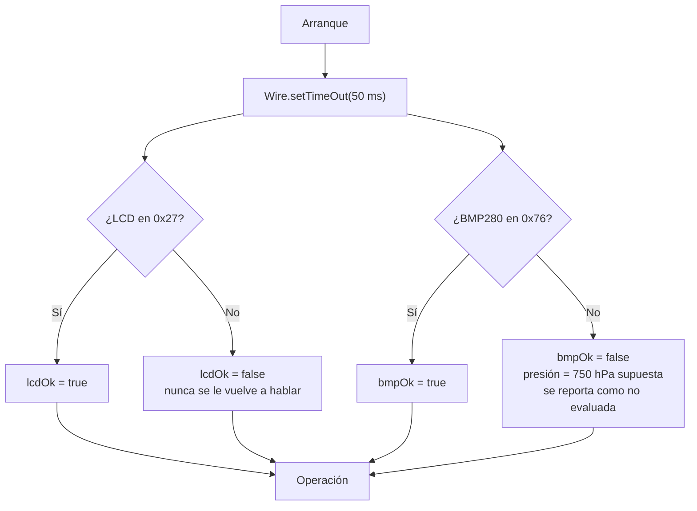

# 6. Implementación

## 6.1 Lista de materiales

| Componente | Cantidad | Costo aprox. (COP) | Observación |
|---|---|---|---|
| ESP32-WROOM-32 DevKit | 1 | 35.000 | Reutilizado del Ch #1 |
| HC-SR04 | 1 | 12.000 | Reutilizado del Ch #1 |
| DHT22 (AM2302) | 1 | 25.000 | Reutilizado del Ch #1 |
| BMP280 | 1 | 15.000 | Nuevo |
| Módulo LDR | 1 | 5.000 | Reutilizado del Ch #1 |
| LCD 16×2 con adaptador I²C | 1 | 25.000 | Reutilizado del Ch #1 |
| Zumbador activo + 2N2222 + 1N4148 | 1 | 8.000 | Reutilizado del Ch #1 |
| LED (verde, amarillo, rojo) + 220 Ω | 3 | 3.000 | Nuevo |
| Resistencias 1 kΩ, 2 kΩ, 10 kΩ | — | 5.000 | Divisor y pull-up |
| Interruptor de palanca | 1 | 3.000 | Corte sin abrir la carcasa |
| Power bank 10.000 mAh | 1 | 35.000 | Alimentación |
| Caja hermética + pasacables + silicona | 1 | 18.000 | Carcasa |
| Tubo PVC ½" + accesorios | — | 20.000 | Arco y estructura |
| **Subtotal dispositivo** | | **≈ 118.000** | |
| Recipiente transparente 20–30 L | 1 | 45.000 | Banco de pruebas |
| Lámpara incandescente 100 W + portalámparas | 1 | 12.000 | Banco de pruebas |
| Consumibles (cable, jumpers, tornillería) | — | 18.000 | |
| **TOTAL** | | **≈ 193.000** | Desembolso nuevo |

El valor total de materiales, incluyendo lo reutilizado, asciende a **$246.000 COP**.

---

## 6.2 Decisiones de implementación física

### El arco fijo

El sensor de nivel **no puede ir sobre la plataforma flotante**: subiría con el agua y leería siempre la misma distancia. Por eso se monta en un arco de PVC apoyado en los bordes del recipiente, que aporta la referencia fija que un flotador no tiene.

El travesaño debe quedar **perfectamente horizontal** y el sensor perpendicular a la superficie. Con un cono de emisión de 15°, una inclinación de pocos grados hace que el eco rebote en la pared del recipiente en lugar de en el agua.

### El abrigo ventilado

El DHT22 va en un abrigo externo con celosías, fuera de la caja y a la sombra. Es la práctica que recomienda la Guía CIMO [14]: un sensor de temperatura expuesto al sol o en contacto térmico con la carcasa deja de medir el aire y pasa a medir su propio alojamiento.

Esto importa doblemente aquí, porque esa temperatura **corrige la velocidad del sonido** del ultrasónico: un sesgo en el DHT22 se propaga directamente al nivel medido.

### El interruptor en la pared

Una vez sellada la caja, cortar la energía exigiría romper el sellado. El interruptor de palanca se monta atravesando la pared, con el sellado hecho una sola vez a su alrededor. Permite además las pruebas de reinicio y persistencia en NVS sin desconectar nada.

El agujero se hace **antes** de sellar: perforar una carcasa ya sellada es la forma más común de arruinarla.

---

## 6.3 Estructura del firmware

```
EstacionHidro/
├── EstacionHidro.ino    Lógica principal: tareas, ISR, fusión, servidor
├── config.h             Todos los parámetros ajustables, documentados
└── pagina.h             Tablero HTML/CSS/JS embebido en PROGMEM
```

La separación es deliberada: **todo lo que un operador podría necesitar cambiar vive en `config.h`**, con comentarios que indican de dónde sale cada valor y cuáles deben medirse en banco.

### Módulos de software

| Función | Responsabilidad | Núcleo |
|---|---|---|
| `isrEcho()` | Captura de flancos del eco con `micros()` | 0 (ISR) |
| `medirDistanciaCm()` | Un disparo con corrección por temperatura | 0 |
| `medirNivelCm()` | Mediana de N disparos y cálculo de dispersión | 0 |
| `banderaPrimaria()` | Traduce el bitmask a bandera QARTOD | 0 |
| `caudalLmin()` | Curva de gasto | 0 |
| `evapPenman()` / `evapHargreaves()` | Evapotranspiración | 0 |
| `evaluarAlerta()` | Fusión, corroboración, persistencia e histéresis | 0 |
| `guardarHistorico()` | Búfer circular protegido por mutex | 0 |
| `rutaDatos()` / `rutaHistorico()` | Serialización JSON | 1 |
| `rutaCalibrar()` / `rutaSilenciar()` | Configuración y actuación remota | 1 |
| `refrescarLcd()` | Rotación de cuatro pantallas | 1 |
| `actualizarAlarma()` | Semáforo y zumbador | 1 |

---

## 6.4 Tolerancia a fallos

El firmware **detecta al arrancar qué hardware responde** y se adapta. Esta capacidad surgió de un incidente real durante el montaje (§8.5) y se incorporó como característica de diseño.



Tres principios:

1. **Nunca se consulta un dispositivo que no respondió.** Una operación I²C sobre un bus caído espera el timeout completo y puede atascar la tarea.
2. **La ausencia de un sensor degrada el servicio, no lo interrumpe.** Sin BMP280 el sistema sigue midiendo nivel, temperatura, humedad y luz.
3. **Un valor supuesto se declara como tal.** El LCD muestra `SUP` en lugar de `hPa`, el tablero dice "valor supuesto · sensor ausente", y el JSON expone `bmpOk: 0`. **El sistema nunca presenta un dato inventado como si fuera medido.**

---

## 6.5 El tablero de control

Servido desde PROGMEM, sin CDN ni librerías externas, porque la WLAN no tiene salida a Internet. La gráfica del histórico es SVG generado en el navegador a partir del JSON.

| Elemento | Contenido |
|---|---|
| Encabezado | Estado de alerta y botón de silenciar |
| Tarjetas | Valor actual de las 7 variables |
| Gráfica | Histórico de 24 h, 6 series seleccionables |
| Calidad del dato | Bandera QARTOD y lista de pruebas fallidas |
| Desempeño de alarmas | Tasa por 10 min, pico y total (EEMUA 191) |

Refresca el valor actual cada 2 s y el histórico cada 60 s.

### Autoevaluación del sistema

El tablero muestra un indicador poco habitual: la **tasa de alarmas por cada 10 minutos**, contabilizando transiciones a estado de alarma —que es como EEMUA 191 cuenta los eventos anunciados al operador— y no muestras en alarma.

El objetivo de la norma es **≤ 1 alarma cada 10 minutos** en operación estable. Que el sistema mida su propio desempeño frente a ese criterio y lo exhiba es, en sí mismo, una aplicación del estándar.

---

## 6.6 Despliegue real: qué cambiaría

El prototipo es una maqueta funcional a escala aproximada 1:20. Para un despliegue en un punto crítico real:

| Elemento | Prototipo | Despliegue real |
|---|---|---|
| Carcasa | Caja hermética plástica | **IP65** con prensaestopas certificados |
| Alimentación | Power bank 10.000 mAh | Panel solar 10 W + TP4056 + 18650 con diodo Schottky |
| Estructura | Arco de PVC ½" | Mástil anclado o soporte sobre obra civil |
| Nivel | HC-SR04 (2–400 cm) | Ultrasónico industrial o sonda de presión sumergible |
| Pozo | — | Pozo tranquilizador para amortiguar oleaje |
| Umbrales | Q80/Q90 de la línea base | Q80/Q90 sobre 10 años de registro IDEAM |
| Conectividad | WLAN local | LoRaWAN al gateway municipal (ver Actividad 2.3) |

El costo adicional estimado es de unos **$450.000 por nodo**.
