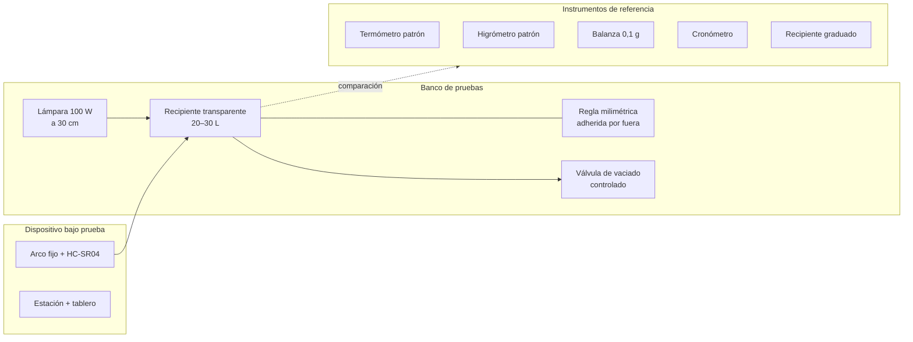

# 7. Banco de pruebas

El enunciado exige un experimento que valide la solución de forma rigurosa, con seis componentes mínimos. Esta sección documenta el protocolo; la §8 reporta los resultados.

> **Nota sobre el estado de los datos.** Las celdas marcadas con `⟨PENDIENTE⟩` corresponden a mediciones que el equipo debe completar y registrar. No se reportan valores no medidos.

---

## 7.1 Montaje experimental

### Justificación del montaje

| Elemento | Función | Por qué así |
|---|---|---|
| Recipiente **transparente** | Cuerpo de agua a escala | Permite leer la regla sin abrir el montaje y filmar el nivel |
| Regla adherida **por fuera** | *Ground truth* del nivel | No interfiere con el eco ultrasónico |
| Lámpara incandescente 100 W | Emulación de radiación y calor | Fuerza evaporación medible en horas, no en días. Se descartó una halógena de 500 W por riesgo térmico sobre plástico y agua |
| Válvula de aguja | Emulación de caudal | Permite descensos repetibles y graduables |
| Balanza 0,1 g | *Ground truth* de evaporación | En un recipiente de 30 × 20 cm, **120 g perdidos = 1 mm de lámina** |

---

## 7.2 Prueba 1 · Calibración contra referencia conocida

**Objetivo.** Obtener la curva de calibración del nivel y cuantificar exactitud y error frente a la regla.

**Procedimiento.**
1. Recipiente vacío. Medir con regla la distancia de la cara del sensor al fondo seco y cargarla por `/api/calibrar?altura=`.
2. Verificar que el nivel reportado sea 0 ± 0,3 cm.
3. Llenar en pasos de 2 cm hasta el máximo, anotando el par (regla, sensor) en cada escalón.
4. Vaciar en los mismos pasos, **para detectar histéresis del instrumento**.
5. Repetir la secuencia con la lámpara encendida y el aire estabilizado a ~40 °C.

**Criterios de aceptación.**

| Métrica | Criterio |
|---|---|
| Error absoluto del nivel | ≤ 3 mm |
| Coeficiente de determinación R² | ≥ 0,99 |
| Diferencia subida/bajada (histéresis) | ≤ 2 mm |
| Temperatura vs. patrón | ± 1 °C |
| Humedad vs. patrón | ± 5 % HR |
| Coincidencia de curvas a 18 °C y 40 °C | Dentro de tolerancia |

El último criterio es el que **valida la corrección por temperatura de la velocidad del sonido**: si sin corregir las dos curvas no coinciden y con corrección sí, queda demostrado el aporte de esa fusión cooperativa.

---

## 7.3 Prueba 2 · Emulación acelerada de condiciones reales

**Objetivo.** Provocar los eventos críticos en tiempo corto.

| Condición emulada | Método | Verificación |
|---|---|---|
| Radiación y calor extremo | Lámpara 100 W a 30 cm | Temperatura y luz suben en el tablero |
| Evaporación | Lámpara encendida 4 h, sin tocar nada | Descenso de regla y pérdida de masa |
| Descenso de nivel | Válvula de aguja | Nivel y caudal derivado reaccionan |
| Humedad alta | Vaho o paño húmedo cercano | HR sube de 90 % en segundos |
| Noche / nubosidad | Cubrir el LDR | Índice de luz cae, evaporación estimada baja |

**Criterio de aceptación.** La evaporación acumulada estimada debe quedar dentro del **±30 %** del descenso real medido en regla y confirmado por balanza.

> El ±30 % se fija deliberadamente amplio y se justifica: la estimación no mide viento y obtiene la radiación por proxy. Exigir un ±10 % sería afirmar una exactitud que el instrumental no respalda.

---

## 7.4 Prueba 3 · Validación de la lógica de fusión y los umbrales

**Objetivo.** Comprobar que las alertas se disparan cuando deben y que se minimizan falsos positivos y negativos.

**Procedimiento.** Veinte casos etiquetados de antemano, provocados en el banco o inyectados por consola serie:

| Tipo de caso | Cantidad | Etiqueta verdadera |
|---|---|---|
| Descenso real sostenido con calor | 5 | Evento |
| Descenso lento dentro de lo normal | 5 | No evento |
| Pico aislado (mano frente al sensor) | 4 | No evento |
| Falla de sensor (desconexión) | 3 | Falla |
| Evaporación alta sin descenso | 3 | No evento |

**Matriz de confusión.**

|  | Alarma activada | Alarma no activada |
|---|---|---|
| **Era evento** | Verdadero positivo | **Falso negativo** |
| **No era evento** | **Falso positivo** | Verdadero negativo |

$$\text{Sensibilidad} = \frac{VP}{VP+FN}, \quad \text{Precisión} = \frac{VP}{VP+FP}$$

**Criterio de aceptación.** **Cero falsos negativos** y máximo **un falso positivo** en veinte casos.

> La asimetría es deliberada. En un sistema de alerta de desabastecimiento, un falso negativo cuesta mucho más que un falso positivo: no avisar de una sequía real tiene consecuencias materiales sobre el abastecimiento; una alarma de más cuesta una revisión. El umbral se ajusta hacia la sensibilidad y se acepta algún falso positivo.

Si el criterio no se cumple, **no se ajusta el umbral a ojo**: se repite la evaluación con Q70, Q80 y Q90 y se reporta la tabla comparativa.

---

## 7.5 Prueba 4 · Notificación: alarma física y tablero

| Métrica | Procedimiento | Criterio |
|---|---|---|
| Latencia de la alarma física | Cronómetro desde que el nivel cruza el umbral hasta que suena | < 10 s (6 s de on-delay + margen) |
| Latencia del tablero | Cronómetro hasta que el valor aparece, en dos dispositivos | < 5 s |
| Actualización del histórico | Verificar un registro nuevo cada 5 min | 12 registros/hora |
| **Desactivación remota** | Pulsar "Silenciar alarma" con la alarma roja activa | Zumbador calla < 3 s; LED rojo **sigue encendido** |
| Expiración del silencio | Esperar 15 min con la condición activa | El zumbador vuelve solo |
| Escalada durante el silencio | Silenciar en amarilla y forzar roja | El zumbador suena pese al silencio |
| Autonomía de la alarma | Apagar el router con la alarma activa | LCD, semáforo y zumbador siguen operando |

Las tres últimas pruebas verifican las salvaguardas del *shelving* según ISA-18.2: el silencio no puede ocultar una condición ni ser indefinido.

---

## 7.6 Prueba 5 · Robustez y casos límite

| Caso | Procedimiento | Criterio |
|---|---|---|
| Valor fuera de rango | Obstruir el sensor a < 2 cm | Bandera QARTOD 4, no se usa el dato |
| Desconexión de sensor en caliente | Retirar el DHT22 en operación | Se señaliza; el sistema **no se reinicia** |
| Pérdida de WLAN | Apagar el punto de acceso 5 min | LCD y alarma siguen; reconecta solo |
| Reconexión | Reactivar el punto de acceso | < 30 s sin intervención manual |
| **Acceso no autorizado** | Abrir el tablero sin credenciales | Respuesta **401**, sin exponer datos |
| Credencial incorrecta | Usuario válido, clave errónea | 401 |
| Corte de energía | Accionar el interruptor y restituir | Conserva calibración y extremos desde NVS |
| Sensor ausente al arranque | Arrancar sin BMP280 | Opera degradado; declara el valor supuesto |

La prueba de acceso restringido es un **requisito explícito del enunciado** y debe documentarse con captura del 401.

---

## 7.7 Prueba 6 · Repetibilidad, precisión y desempeño

| Métrica | Procedimiento | Criterio |
|---|---|---|
| Repetibilidad del nivel | 30 mediciones con nivel fijo | Desviación estándar ≤ 3 mm |
| Reproducibilidad | Repetir en 3 condiciones de luz y temperatura | Coeficiente de variación < 3 % |
| Ruido de la señal | 150 muestras en reposo | Registrar dispersión y desviación estándar |
| **Tasa de alarmas** | 4 h de operación normal, contador del tablero | **≤ 1 por cada 10 min** (EEMUA 191) |
| Consumo | Multímetro en serie durante un ciclo de 10 min | Registrar media y pico |
| Autonomía | Descarga real del power bank | Estimar horas de operación |

La medición de ruido cumple doble función: valida la repetibilidad **y** entrega el número que justifica la histéresis del 5 % (§5.3).

---

## 7.8 Cronograma del banco

| Prueba | Atención activa | Duración total |
|---|---|---|
| 1 · Calibración | 45 min | 45 min |
| 2 · Emulación acelerada | 10 min | 4 h (desatendida) |
| 3 · Fusión y umbrales | 40 min | 40 min |
| 4 · Notificación | 30 min | 45 min |
| 5 · Robustez | 30 min | 30 min |
| 6 · Repetibilidad y desempeño | 15 min | 12 h (desatendida) |
| **Total** | **≈ 2 h 50 min** | |

La línea base para los percentiles Q80 y Q90 se obtiene de la corrida desatendida de la prueba 6, que se ejecuta durante la noche y no consume tiempo del equipo.
