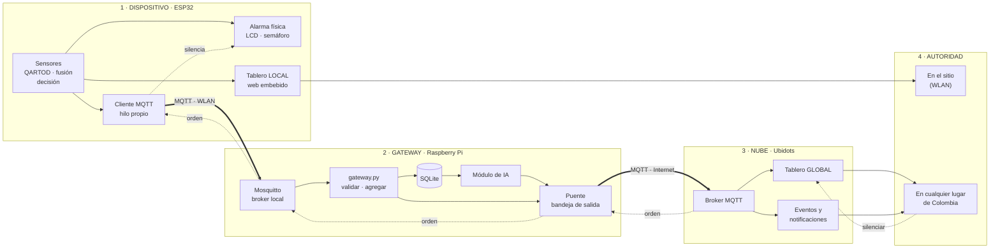
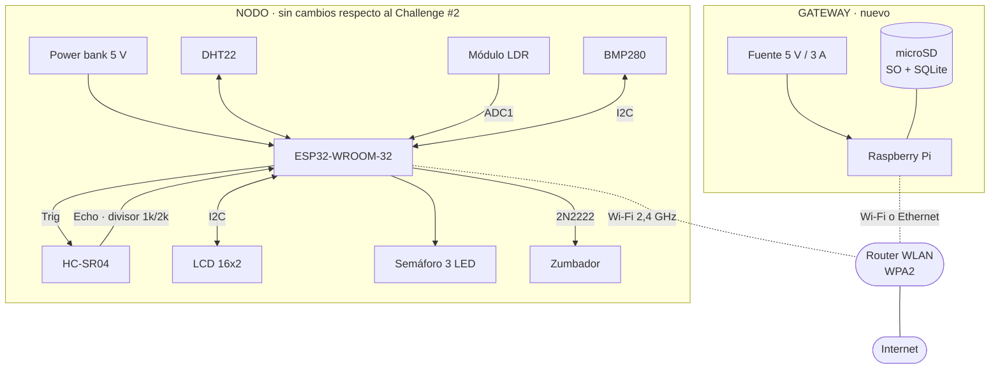
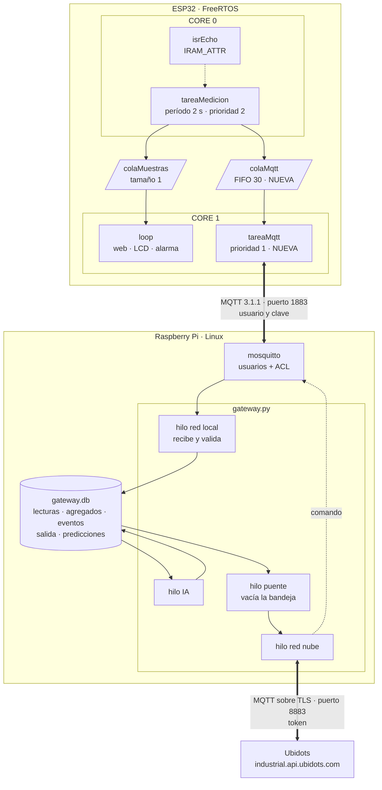
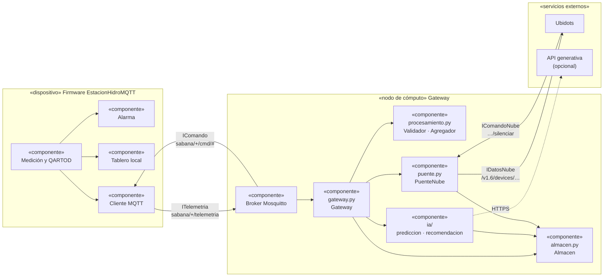
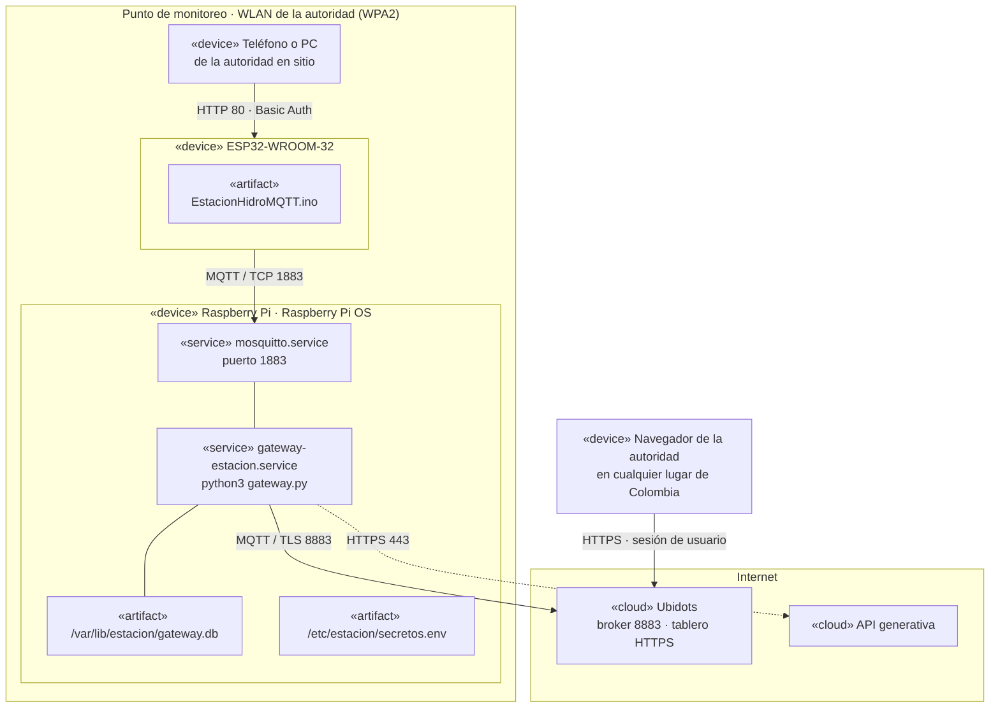
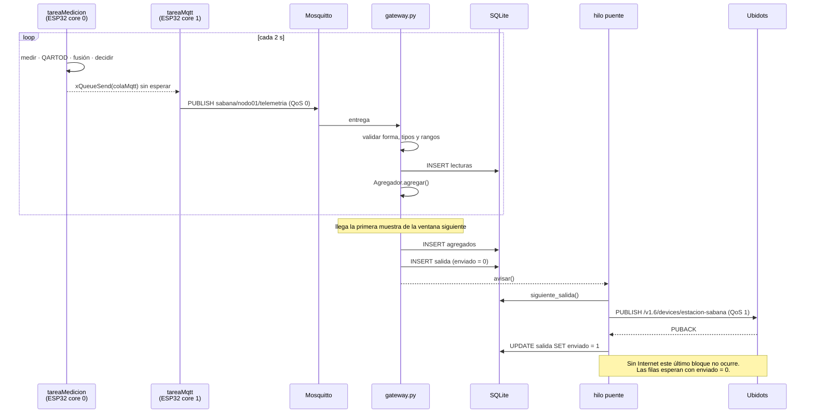
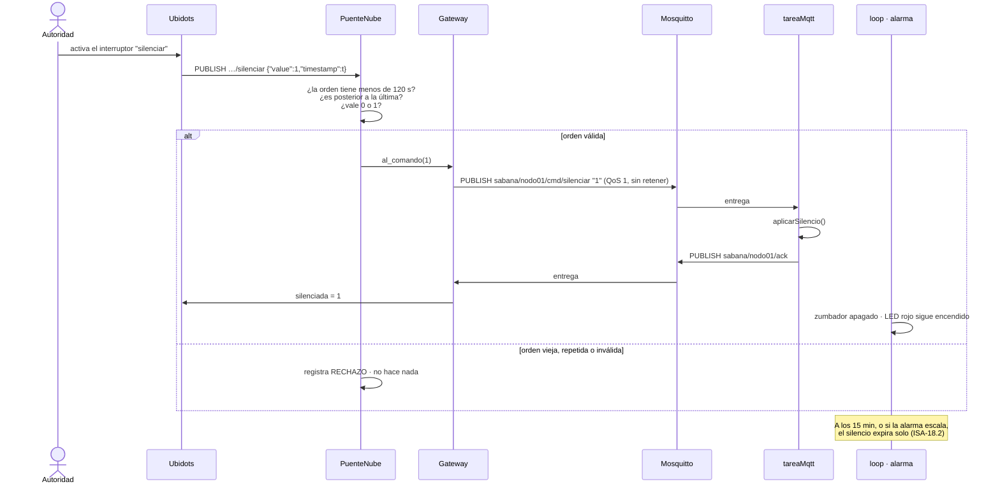

# C3.3 · Arquitectura

## 3.1 Las cuatro capas del ecosistema

El Challenge #2 era un nodo. El Challenge #3 es una cadena de cuatro eslabones, y cada uno tiene una razón para existir que los otros tres no pueden cubrir.

Las flechas gruesas son el dato que sube. Las punteadas son la orden que baja: el enunciado exige poder **desactivar la alarma física** desde el tablero, y ahora ese tablero puede estar a cientos de kilómetros. La orden recorre los dos tramos MQTT en sentido contrario.

### Qué hace cada capa que las otras no pueden

| Capa | Lo que solo ella puede hacer | Si desaparece |
|---|---|---|
| **Dispositivo** | Decidir en 6 s y hacer sonar la alarma **sin depender de nadie** | No hay sistema |
| **Gateway** | Guardar historia, calcular tendencias de horas y sostener los datos cuando no hay Internet | El nodo sigue alarmando y sirviendo su tablero local; se pierde el histórico largo, la IA y la nube |
| **Nube** | Llegar a quien **no está en el sitio** y notificarle | Todo sigue funcionando en el sitio; los datos esperan en SQLite y se reenvían |
| **Autoridad** | Decidir qué hacer con la alerta | — |

La columna de la derecha es el criterio de diseño heredado del Challenge #2 y llevado a la red: **cada capa degrada sin tumbar a la anterior.**

---

## 3.2 Por qué el Challenge #2 prohibía MQTT y este lo exige

No es una contradicción, es un cambio de escala.

Un nodo **autónomo** no debe depender de un broker: si el broker cae, un sistema de alerta que lo necesite para alarmar deja de alertar. Por eso en el Challenge #2 la decisión y la alarma se resolvieron dentro del ESP32, y eso **no se tocó**.

Una **red** de nodos sí necesita un intermediario: alguien tiene que recibir a muchos, guardar lo que dicen y hablar con Internet por todos. Eso es el broker más el Gateway.

La arquitectura del Challenge #3 conserva las dos cosas: MQTT se **agrega** como canal de transporte, pero ninguna función de seguridad depende de él. La prueba de ello es que el firmware trata al broker como opcional: si no responde, quien espera es un hilo aparte ([§4.2](C3.4-Diseno-modular)).

---

## 3.3 Diagrama de bloques de hardware

**El hardware del nodo no cambia en nada.** Ni un cable. El esquemático, el mapa de pines y las notas de diseño del Challenge #2 siguen vigentes y están en [Arquitectura (Ch2) §3.2](3.-Arquitectura). Todo lo nuevo en el nodo es firmware.

El Gateway no lleva electrónica adicional: Raspberry Pi, fuente y tarjeta microSD. No usa GPIO.

---

## 3.4 Diagrama de bloques de software

### Los hilos y por qué cada cosa va en el suyo

| Dónde | Hilo | Qué hace | Por qué separado |
|---|---|---|---|
| ESP32 core 0 | `tareaMedicion` | Mide, valida, decide | Período estricto de 2 s. **Sin cambios** |
| ESP32 core 0 | `isrEcho` | Captura el eco | Latencia mínima. **Sin cambios** |
| ESP32 core 1 | `loop` | Tablero local, LCD, alarma | **Sin cambios** |
| ESP32 core 1 | **`tareaMqtt`** | Conecta, publica, recibe comandos | Un broker que no responde bloquea hasta 3 s: que bloquee a este hilo y a ningún otro |
| Raspberry | red local | Recibe del broker | Lo crea la librería; no debe esperar a nada lento |
| Raspberry | **IA** | Análisis y consulta al modelo generativo | La consulta a la API puede tardar 8 s |
| Raspberry | **puente** | Envía a la nube | Respeta 1 mensaje/s; sin Internet simplemente espera |
| Raspberry | red nube | Mantiene la conexión con Ubidots | Reintenta sola con espera creciente |

La restricción técnica 1 del enunciado —*"la medición y transmisión de los datos deberán ejecutarse mediante rutinas de servicio de interrupción (ISR) o hilos independientes del hilo principal"*— queda cubierta así: la **medición** con una ISR y una tarea en el core 0 (Challenge #2), y la **transmisión** con `tareaMqtt`, una tarea propia distinta de `loop()`.

---

## 3.5 UML de la solución · diagrama de componentes

Las cuatro interfaces con nombre son los **contratos** del sistema. Están especificadas campo por campo en [§4.1](C3.4-Diseno-modular). Mientras se respeten, cualquier componente puede reemplazarse sin tocar los demás: de hecho, la validación de este proyecto reemplazó el firmware por un simulador y Ubidots por un broker de prueba sin modificar una línea del Gateway ([§7](C3.7-Configuracion-experimental)).

---

## 3.6 UML de la solución · diagrama de despliegue

---

## 3.7 Diagrama de secuencia · un dato, de sensor a pantalla

El orden de las dos operaciones del Gateway es deliberado: **primero se escribe en disco, después se intenta enviar.** Un dato que no ha llegado a SQLite todavía no existe para el resto del sistema. Es el patrón *transactional outbox*, y es lo que hace que una caída de Internet no pierda datos ([§8.5](C3.8-Resultados-y-analisis)).

---

## 3.8 Diagrama de secuencia · la orden de silenciar

El filtro de antigüedad no es un detalle. Cuando un cliente MQTT se reconecta, la plataforma puede reenviarle el último valor de la variable. Sin el filtro, un Gateway que recupera Internet a las tres de la tarde ejecutaría una orden de silencio dada a las nueve de la mañana, sobre una alarma distinta. Se comprobó en simulación que la orden vieja se descarta ([§8.6](C3.8-Resultados-y-analisis)).

---

## 3.9 Los dos tableros

| | Tablero **local** | Tablero **global** |
|---|---|---|
| Dónde corre | Servidor web embebido en el ESP32 | Ubidots |
| Quién lo ve | Quien esté en la WLAN del sitio | Personal autorizado en cualquier lugar |
| Depende de | Solo del ESP32 | ESP32 + Gateway + Internet + Ubidots |
| Refresco | 2 s | 5 min; alertas al instante |
| Histórico | 24 h en RAM (288 registros) | Lo que retenga la plataforma; completo en SQLite |
| Acceso | WLAN WPA2 + HTTP Basic, credenciales en NVS | Sesión de usuario de la plataforma |
| Silenciar alarma | `GET /api/silenciar` | Interruptor → MQTT → Gateway → nodo |
| Predicción de la IA | No | Sí |
| Notificaciones | No (alarma física) | Correo o mensajería por evento |

No son dos copias de lo mismo. El local es el que **nunca falla** y muestra el instante; el global es el que **llega lejos** y muestra la tendencia. La autoridad en sitio usa el primero; quien decide un racionamiento desde la alcaldía usa el segundo.
