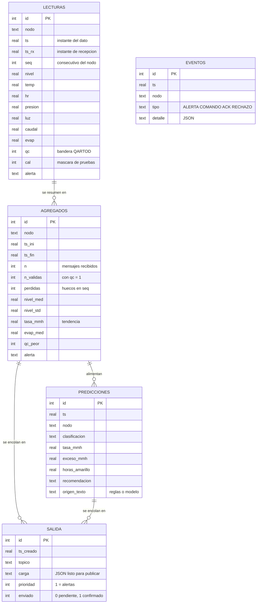
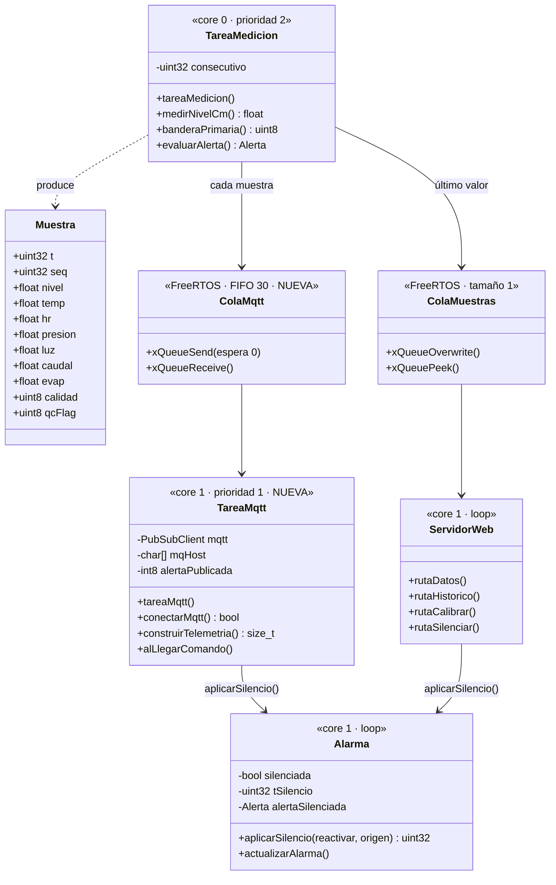
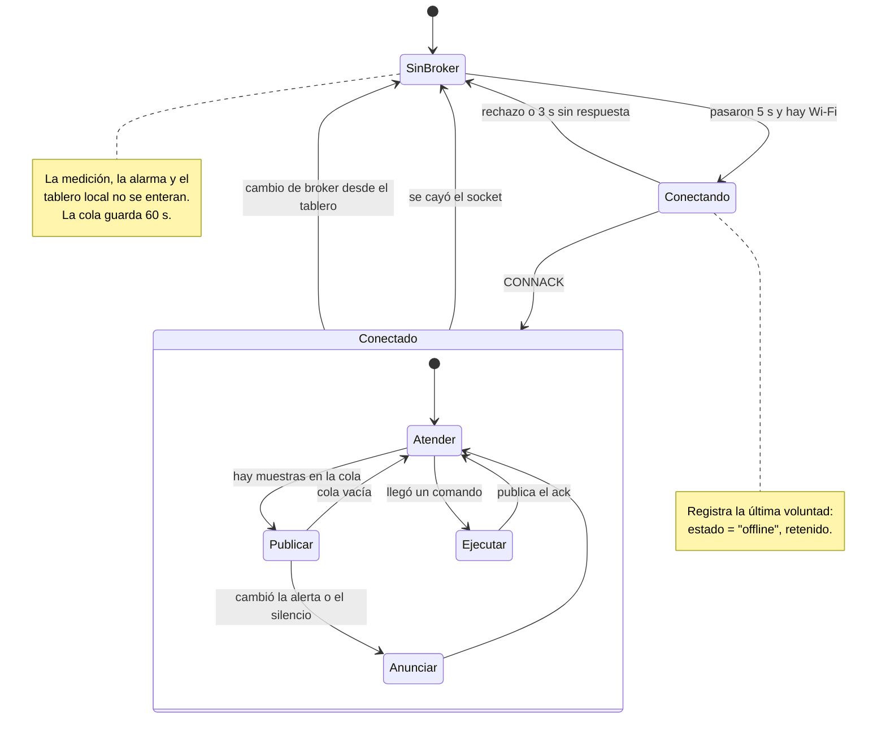
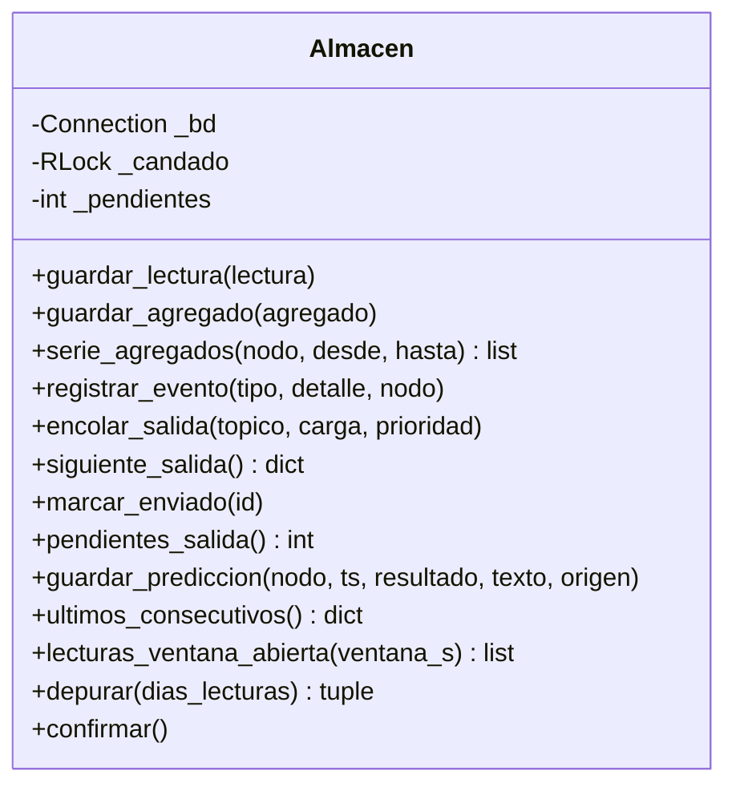
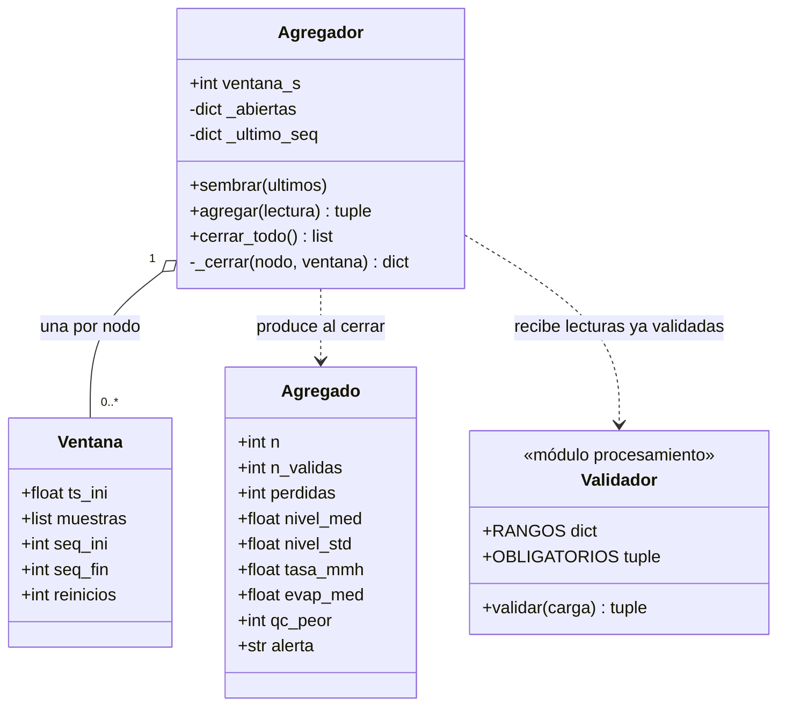
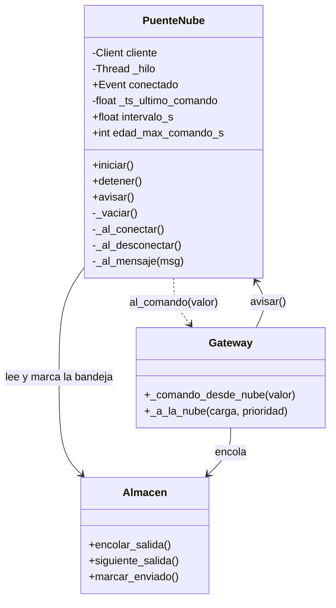
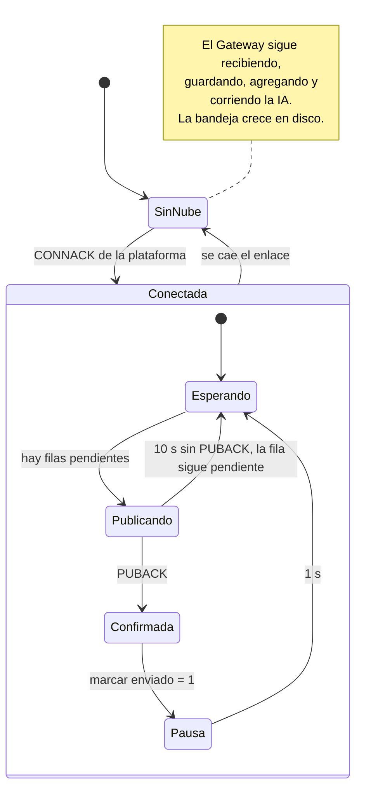
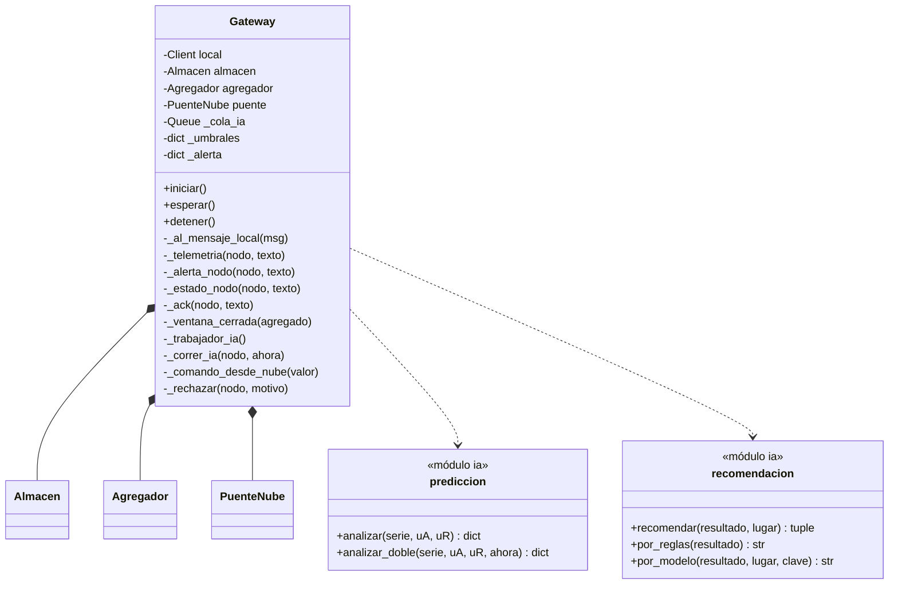

# C3.4 · Diseño modular

Cada módulo se presenta con la misma estructura: **qué hace**, **criterios de diseño**, **diagrama UML** y **estándar que lo respalda**. Los módulos del dispositivo que no cambiaron —medición, QARTOD, fusión, alarma, tablero local— están documentados en [Diseño modular (Ch2)](4.-Diseno-modular) y [Lógica de fusión y umbrales (Ch2)](5.-Logica-de-fusion-y-umbrales), y no se repiten aquí.

| Módulo | Dónde corre | Archivo | Sección |
|---|---|---|---|
| Contratos de datos | — | — | [4.1](#41-contratos-de-datos) |
| Cliente MQTT del nodo | ESP32 | `firmware/EstacionHidroMQTT/` | [4.2](#42-cliente-mqtt-del-nodo) |
| Broker local | Raspberry | `gateway/mosquitto/` | [4.3](#43-broker-local) |
| Almacenamiento | Raspberry | `gateway/almacen.py`, `esquema.sql` | [4.4](#44-almacenamiento-local) |
| Procesamiento local | Raspberry | `gateway/procesamiento.py` | [4.5](#45-procesamiento-local) |
| Puente a la nube | Raspberry | `gateway/puente.py` | [4.6](#46-puente-a-la-nube) |
| Orquestador | Raspberry | `gateway/gateway.py` | [4.7](#47-orquestador-del-gateway) |
| Módulo de IA | Raspberry | `ia/` | [C3.5](C3.5-Modulo-de-IA) |
| Plataforma en la nube | Ubidots | — | [4.8](#48-plataforma-en-la-nube) |

---

## 4.1 Contratos de datos

Son la parte más importante del diseño: lo único que dos módulos necesitan saber uno del otro. Se fijaron antes de escribir código y permitieron desarrollar y probar cada capa por separado.

### Contrato 1 · Tópicos del broker local

Raíz `sabana/<nodo>/…`. El identificador del nodo va en el tópico, de modo que agregar una segunda estación es agregar un usuario y una rama, sin tocar el Gateway (que se suscribe con comodín `sabana/+/…`).

| Tópico | Sentido | QoS | Retenido | Contenido |
|---|---|---|---|---|
| `sabana/<nodo>/telemetria` | Nodo → Gateway | 0 | No | Las 7 variables + calidad, cada 2 s |
| `sabana/<nodo>/alerta` | Nodo → Gateway | 0 | **Sí** | Estado de la alarma, **solo cuando cambia** |
| `sabana/<nodo>/estado` | Nodo → Gateway | 0 · última voluntad en 1 | **Sí** | `online` / `offline` (última voluntad) |
| `sabana/<nodo>/cmd/silenciar` | Gateway → Nodo | 1 | **No** | `1` silencia · `0` reactiva |
| `sabana/<nodo>/ack` | Nodo → Gateway | 0 | No | Confirmación de la orden ejecutada |
| `sabana/<nodo>/agregado` | Gateway → WLAN | 0 | Sí | Resultado de cada ventana |
| `sabana/<nodo>/prediccion` | Gateway → WLAN | 0 | Sí | Resultado del módulo de IA |
| `sabana/gateway/estado` | Gateway → WLAN | 1 | Sí | `online` / `offline` (última voluntad) |

#### Por qué cada tópico tiene ese QoS y esa retención

Ninguna de las dos columnas es un valor por defecto. Cada celda es una decisión:

| Decisión | Razón |
|---|---|
| Telemetría en **QoS 0** | Llega una muestra nueva cada 2 s. Reintentar una muestra perdida gastaría más de lo que vale: la siguiente ya viene en camino. Lo que no se puede permitir es perderla **sin saberlo**, y de eso se ocupa el consecutivo `seq` |
| Telemetría **sin retener** | Un dato de hace una hora presentado como "el último" es peor que no tener dato |
| Alerta **retenida** | Un Gateway que arranca después de que la alarma se activó debe conocer el estado vigente de inmediato, no esperar al siguiente cambio |
| Estado **retenido + última voluntad** | Si el nodo se queda sin energía no alcanza a despedirse. El broker publica `offline` por él cuando deja de oír su *keepalive* |
| Comando en **QoS 1** | Una orden de silencio no puede perderse por un paquete caído |
| Comando **sin retener** | Una orden de silencio **no debe ejecutarse más tarde**. Si el nodo no está, la orden se pierde a propósito |

> **Una limitación que se declara.** La librería `PubSubClient` del ESP32 solo publica en QoS 0. La telemetría y el `ack` van en QoS 0 por diseño; la alerta también va en QoS 0 por limitación de la librería. Se compensa de dos formas: la alerta va **retenida** (el broker la conserva) y además **viaja dentro de cada mensaje de telemetría** (campo `alerta`), de modo que el Gateway la reconstruye en 2 s aunque el mensaje de transición se pierda.

### Contrato 2 · Carga de la telemetría

```json
{
  "id": "nodo01",     "seq": 4821,      "up": 9642,
  "nivel": 18.52,     "temp": 19.8,     "hr": 61.2,    "presion": 752.1,
  "luz": 44.0,        "caudal": 3.012,  "evap": 3.41,
  "qc": 1,            "cal": 0,
  "alerta": "VERDE",  "sil": 0,         "bmp": 1,
  "uA": 12.0,         "uR": 8.0
}
```

| Campo | Tipo | Unidad | Significado |
|---|---|---|---|
| `id` | texto | — | Identificador del nodo. Debe coincidir con el del tópico |
| `seq` | entero | — | Consecutivo desde el arranque. **Detecta pérdidas y reinicios** |
| `up` | entero | s | Tiempo encendido |
| `nivel` | número o `null` | cm | Nivel sobre el fondo. `null` = sin eco |
| `temp`, `hr`, `presion`, `luz` | número | °C, %, hPa, % | Variables medidas |
| `caudal` | número o `null` | L/min | Derivada: curva de gasto |
| `evap` | número | mm/día | Derivada: Penman-Monteith FAO-56 |
| `qc` | 1, 2, 3, 4, 9 | — | Bandera primaria QARTOD |
| `cal` | 0–255 | — | Máscara: qué prueba falló |
| `alerta` | texto | — | `VERDE` · `AMARILLA` · `ROJA` · `FALLA` |
| `sil` | 0 / 1 | — | Alarma sonora silenciada |
| `bmp` | 0 / 1 | — | 0 = la presión es un valor supuesto, no medido |
| `uA`, `uR` | número | cm | Umbrales vigentes en el nodo (Q80 y Q90) |

Tres decisiones de este contrato:

**El nodo no fecha sus mensajes.** El ESP32 no tiene reloj de pared y no se le debe exigir Internet para sincronizarlo. Envía `seq` y `up`; **la marca de tiempo la pone el Gateway al recibir**. La latencia nodo→Gateway es de milisegundos frente a un período de 2 s, así que el error es despreciable.

**Los umbrales viajan en el mensaje.** Los umbrales se calibran en el nodo (`/api/calibrar`, guardados en NVS). En vez de duplicar esa configuración en el Gateway —y arriesgar que diverjan— el nodo los informa y el módulo de IA usa siempre los vigentes. Una sola fuente de verdad.

**Lo que falta viaja como `null`, no como cero ni como `NaN`.** `NaN` no es JSON válido, y un cero es una medición. El firmware convierte explícitamente (`numOnull()`).

### Contrato 3 · Esquema de SQLite

Cinco tablas. El DDL completo y comentado está en [`gateway/esquema.sql`](https://github.com/tomasarro13/estacion-hidrometeorologica-sabana-centro/blob/main/gateway/esquema.sql).



### Contrato 4 · Variables de la nube

Publicación en `/v1.6/devices/estacion-sabana`, cada variable con su marca de tiempo propia (la del **dato**, no la del envío: un dato reenviado tras una caída de Internet aparece en su hora real).

```json
{ "nivel": {"value": 18.52, "timestamp": 1794300300000},
  "alerta": {"value": 0, "timestamp": 1794300300000} }
```

| Variable | Origen | Frecuencia | Datos/día |
|---|---|---|---|
| `nivel`, `caudal`, `temp`, `hr`, `presion`, `luz`, `evap` | Agregado | 5 min | 7 × 288 = 2 016 |
| `tasa_mmh`, `alerta`, `qc` | Agregado | 5 min | 3 × 288 = 864 |
| `anomalia`, `horas_umbral`, `exceso_mmh` | Módulo de IA | 30 min | 3 × 48 = 144 |
| `alerta`, `silenciada`, `en_linea` | Eventos | Al cambiar | Variable |
| **Total en operación estable** | | | **≈ 3 024** |

El plan gratuito de la plataforma admite **4 000 datos al día y 1 mensaje por segundo** [C3-6]. Ese número fijó la ventana de agregación ([§4.5](#45-procesamiento-local)).

---

## 4.2 Cliente MQTT del nodo

**Qué hace.** Publica cada muestra, anuncia cada cambio de alarma, mantiene su presencia y ejecuta las órdenes que llegan. Es **lo único que se agregó al firmware**.

### Criterios de diseño

**1. Transmitir nunca frena medir.** La tarea de medición entrega cada muestra a una cola con `xQueueSend(…, 0)`: tiempo de espera cero. Si la cola está llena porque el broker no responde, descarta la muestra **más antigua** y sigue. La medición no sabe si hay red.

**2. Un broker caído bloquea un hilo, y solo ese.** `tareaMqtt` es una tarea propia en el core 1 con prioridad 1, por debajo de la medición (2). El tiempo de espera del socket se limita a 3 s (`setSocketTimeout`). En el Challenge #2 ya se pagó este error una vez: un bus I²C caído bloqueaba `loop()` y tumbaba el servidor web. No se repite.

**3. La librería MQTT la toca un único hilo.** `PubSubClient` no es segura entre hilos. Toda llamada a `mqtt.*` ocurre dentro de `tareaMqtt`, incluido el `ack`, porque el *callback* de comandos se ejecuta dentro de `mqtt.loop()`.

**4. Un minuto de respaldo.** La cola guarda 30 muestras (30 × 2 s). Una reconexión Wi-Fi corta no pierde datos; una caída larga sí, y se nota en el consecutivo.

**5. El broker se cambia sin recompilar.** `GET /api/calibrar?mqtt=192.168.1.50` guarda la dirección en NVS y la tarea reconecta. La copia de las credenciales entre el hilo del servidor web y `tareaMqtt` se hace bajo sección crítica.

**6. Una sola función silencia, venga la orden de donde venga.** `aplicarSilencio()` atiende al tablero local (HTTP) y al global (MQTT). Las salvaguardas de ISA-18.2 —expira a los 15 min, expira si la condición desaparece, expira si la alarma escala— viven en `actualizarAlarma()` y por tanto aplican igual a las dos vías.

### Diagrama de clases del firmware (lo nuevo, en contexto)



### Máquina de estados de `tareaMqtt`



**Estándar aplicado.** MQTT 3.1.1 (OASIS; ISO/IEC 20922:2016) [C3-1], [C3-2]: sesión limpia, *keepalive* de 15 s, última voluntad (*Will*), mensajes retenidos y jerarquía de tópicos con comodines.

---

## 4.3 Broker local

**Qué hace.** Recibe a los nodos y reparte al Gateway. Es Eclipse Mosquitto, sin modificar.

### Criterios de diseño

**1. Nadie entra sin credenciales.** `allow_anonymous false`. Tres usuarios con clave cifrada (`mosquitto_passwd`): `nodo01`, `gateway`, `monitor`.

**2. Mínimo privilegio por tópico.** Una contraseña sola no basta: un nodo comprometido no debe poder hacerse pasar por otro, ni darse órdenes, ni leer la red. La lista de control de acceso lo impide:

| Usuario | Puede escribir | Puede leer |
|---|---|---|
| `nodo01` | Su telemetría, alerta, estado y ack | **Solo** sus comandos |
| `gateway` | Comandos, agregados, predicciones, su estado | Telemetría, alerta, estado y ack de todos los nodos |
| `monitor` | **Nada** | Todo (diagnóstico) |

**3. Lo retenido sobrevive a un reinicio.** `persistence true`: el último estado y la última alerta siguen ahí tras un corte de energía.

Las diez combinaciones de la tabla se verificaron contra el broker real ([§8.2](C3.8-Resultados-y-analisis)).

**Estándar aplicado.** MQTT 3.1.1 [C3-1]; principio de mínimo privilegio de NIST SP 800-53, control AC-6 [C3-9]; recomendaciones de autenticación y control de acceso del OWASP IoT Top 10 [C3-10].

---

## 4.4 Almacenamiento local

**Qué hace.** Guarda todo: el dato crudo, su resumen, la bitácora y lo que está por salir.

### Criterios de diseño

**1. SQLite, no un servidor de base de datos.** Es un archivo. No hay proceso que administrar, puerto que proteger ni servicio que pueda no arrancar. Para un único escritor a 0,5 inserciones por segundo, un motor cliente-servidor sería complejidad sin beneficio. Es la recomendación del enunciado y coincide con el uso para el que SQLite se declara apropiado [C3-4].

**2. Se guarda lo que llega, se filtra al procesar.** La tabla `lecturas` conserva incluso lo que el nodo marcó como dudoso o malo. Descartar es una decisión del procesamiento, y debe poder revisarse después.

**3. Modo WAL.** Con *Write-Ahead Logging* el módulo de IA y las consultas de diagnóstico leen sin bloquear al hilo que escribe [C3-5].

**4. Escritura por lotes, pensando en la tarjeta SD.** Un `commit` por fila son 43 200 sincronizaciones diarias sobre una microSD. Las lecturas se confirman cada 50 filas o cada 2 s, lo que ocurra primero: ante un apagón se arriesgan, como máximo, 2 s de dato crudo. **La bandeja de salida y los eventos, en cambio, se confirman de inmediato**: son pocos y no se pueden perder.

**5. Retención explícita.** El dato crudo de 2 s se conserva 7 días (unas 300 000 filas). Agregados, eventos y predicciones no se borran: son el histórico de largo plazo.

**6. Una sola puerta.** Ningún otro módulo escribe SQL. La clase `Almacen` serializa el acceso de los cuatro hilos con un candado.



---

## 4.5 Procesamiento local

**Qué hace.** Dos cosas, en este orden: rechaza lo que no puede ser un dato del sistema, y reduce la telemetría de 2 s a una fila por ventana.

### Por qué se procesa en el Gateway y no en el nodo ni en la nube

| Lugar | Por qué no |
|---|---|
| En el nodo | No tiene memoria para horas de historia ni debe gastar su ciclo de 2 s en estadística |
| En la nube | Enviar el dato crudo son **388 800 datos al día** (43 200 mensajes × 9 variables). El plan admite 4 000. Y sin Internet no habría procesamiento |
| **En el Gateway** | Tiene la historia, tiene el cómputo, y sigue trabajando sin Internet |

### La ventana de 5 minutos sale de una cuenta, no de una preferencia

| Ventana | Datos/día (10 variables + IA) | ¿Cabe en 4 000? |
|---|---|---|
| 1 min | 14 544 | No |
| 2 min | 7 344 | No |
| **5 min** | **3 024** | **Sí, con 24 % de margen para eventos** |
| 10 min | 1 584 | Sí, pero duplica la latencia del tablero global |

Cinco minutos es además el período del histórico del tablero local (Challenge #2), de modo que los dos tableros muestran la misma resolución.

### Criterios de diseño

**1. Defensa en profundidad.** El nodo ya validó sus lecturas con QARTOD. El Gateway igual no confía en lo que llega por la red: comprueba que sea JSON, que sea un objeto, que tenga los campos obligatorios, los tipos, los rangos físicos, que la bandera pertenezca al esquema y que el `id` coincida con el tópico. Un mensaje rechazado queda en la bitácora con su motivo y **no detiene nada**.

**2. Los rangos del Gateway son más anchos que los del nodo, a propósito.** Aquí no se juzga la calidad de la medición —eso lo hizo QARTOD donde se mide— sino que se descarta lo que no puede ser un dato de este sistema. Humedad de 150 % se rechaza; nivel de 34 cm con bandera 4 se acepta y se guarda.

**3. "Dudoso se muestra, no se usa en cálculos."** Es la regla de QARTOD, aplicada al agregado: la media del nivel solo usa lecturas con bandera 1. Temperatura y humedad excluyen las muestras con falla del DHT22; presión, las de falla del BMP280.

**4. La ventana la cierra el dato, no el reloj.** Se cierra cuando llega una muestra que ya pertenece a la siguiente (*event time*). El resultado es idéntico en vivo y reprocesando, y es lo que permitió validar con tiempo comprimido.

**5. Las pérdidas se cuentan.** Cada agregado dice cuántos mensajes debieron llegar y no llegaron, por el salto del consecutivo. Un `seq` que retrocede se registra como reinicio del nodo.

**6. Sobrevive a su propio reinicio.** Al arrancar, el Gateway recupera el último consecutivo de cada nodo y reconstruye desde SQLite la ventana que quedó abierta. Lo que no recibió mientras estuvo apagado queda **contado como pérdida**, no pasa inadvertido.



**Estándar aplicado.** QARTOD [5] para el criterio de uso de banderas; el patrón de ventanas por tiempo del evento de los sistemas de procesamiento de flujos [C3-8].

---

## 4.6 Puente a la nube

**Qué hace.** Sube lo que hay en la bandeja de salida y baja las órdenes del tablero global.

### Criterios de diseño

**1. Nada se publica directamente.** Todo lo que va a la nube se escribe primero en la tabla `salida`. Un hilo aparte la vacía. Es el patrón *transactional outbox*: el dato existe en disco **antes** de intentarse su envío.

**2. Enviado significa confirmado.** Se publica en QoS 1 y la fila solo se marca cuando llega el `PUBACK` de la plataforma. Si la conexión cae a mitad, la fila sigue pendiente y se reintenta. La garantía es *al menos una vez*; un duplicado no hace daño porque sobrescribe el mismo punto (misma variable, misma marca de tiempo).

**3. Las alertas se cuelan.** La bandeja se ordena por prioridad y luego por llegada. Tras ocho horas sin Internet, lo primero que sale es la transición de alarma, no el dato de hace ocho horas.

**4. Arrancar sin Internet no es un error, es un estado.** La conexión es asíncrona y se reintenta sola con espera creciente (1 a 30 s). El Gateway arranca igual y acumula.

**5. Se respeta el límite de la plataforma.** Un mensaje por segundo. Vaciar una hora de caída (12 ventanas y 2 corridas de IA) toma unos 14 s; vaciar un día entero, menos de seis minutos.

**6. El token no viaja en claro.** TLS por el puerto 8883. El token se lee de una variable de entorno, no del repositorio.

**7. Una orden vieja no se ejecuta.** Ver [§3.8](C3.3-Arquitectura).





**Estándar aplicado.** MQTT 3.1.1, entrega QoS 1 [C3-1]; TLS (RFC 8446) [C3-3]; patrón *transactional outbox* [C3-7].

---

## 4.7 Orquestador del Gateway

**Qué hace.** Conecta los módulos anteriores. No contiene lógica propia de validación, almacenamiento ni análisis: recibe un mensaje y decide a quién pasárselo.



### Criterios de diseño

**1. Un mensaje malo no tumba el Gateway.** Cada manejador corre dentro de un bloque que captura cualquier excepción, la registra y sigue.

**2. Una falla de la IA no tumba el Gateway.** El módulo de IA corre en su propio hilo, con su propia captura. Si falla, se pierde una predicción; no se pierde un dato.

**3. Apagado ordenado.** Con `SIGTERM` (lo que envía `systemd`) confirma la base y publica su `offline`. La ventana en curso no se cierra a medias: se reconstruye completa en el siguiente arranque.

**4. Servicio del sistema.** Unidad de `systemd` con `Restart=always`, usuario sin privilegios y secretos en un archivo de entorno con permisos 640.

**5. Sin dependencias pesadas.** Biblioteca estándar de Python más `paho-mqtt`, que está en los repositorios de Raspberry Pi OS. El código funciona con las versiones 1.x y 2.x de la librería.

---

## 4.8 Plataforma en la nube

**Qué hace.** Presenta el tablero global, guarda la serie, evalúa eventos y notifica.

### Criterios de diseño

**1. La nube no decide la alarma.** La alarma la decide el nodo. La plataforma **reenvía** una decisión ya tomada. Un evento de Ubidots configurado como `alerta ≥ 2` no recalcula nada: reacciona al código que mandó el nodo.

**2. Las variables se crean solas.** El Gateway publica y la plataforma crea la variable al recibir el primer dato. Solo la variable de comando (`silenciar`) se crea a mano.

**3. Acceso restringido por sesión.** El tablero no tiene enlace público. Se entra con usuario y contraseña de la plataforma.

**4. El token es de la cuenta, no del tablero.** Vive únicamente en la Raspberry, en un archivo con permisos restringidos.

La configuración paso a paso —dispositivo, variables, widgets, eventos— está en [C3.6 §6.4](C3.6-Implementacion).

---

## 4.9 Estándares de ingeniería aplicados

Se suman a los siete del Challenge #2 (QARTOD, ISA-18.2, IEC 62682, EEMUA 191, FAO-56, *Threshold Level Method*, WMO No. 8), que siguen vigentes en el nodo.

| Dominio | Estándar o referencia | Dónde se aplica |
|---|---|---|
| Mensajería | **MQTT 3.1.1** · OASIS / ISO/IEC 20922 [C3-1], [C3-2] | QoS por tópico, retención, última voluntad, comodines |
| Seguridad en tránsito | **TLS** · RFC 8446 [C3-3] | Tramo Gateway → nube |
| Control de acceso | **NIST SP 800-53 AC-6**, mínimo privilegio [C3-9] | ACL por usuario y tópico |
| Seguridad IoT | **OWASP IoT Top 10** [C3-10] | Sin credenciales por defecto ni en el código; servicios mínimos |
| Almacenamiento | **SQLite**, modo WAL [C3-4], [C3-5] | Base local del Gateway |
| Fiabilidad | *Transactional outbox* [C3-7] | Bandeja de salida |
| Gestión de alarmas | **ISA-18.2** [6] | El silenciamiento remoto hereda las tres salvaguardas |
| Calidad del dato | **QARTOD** [5] | Uso de banderas en el agregado y en la entrada de la IA |
| Estadística | Estimador de **Theil-Sen** [C3-11], [C3-12] | Tendencia del módulo de IA |
| Arquitectura | **ISO/IEC 30141**, arquitectura de referencia IoT [C3-13] | Separación en dominios: sensado, operación, aplicación, usuario |
