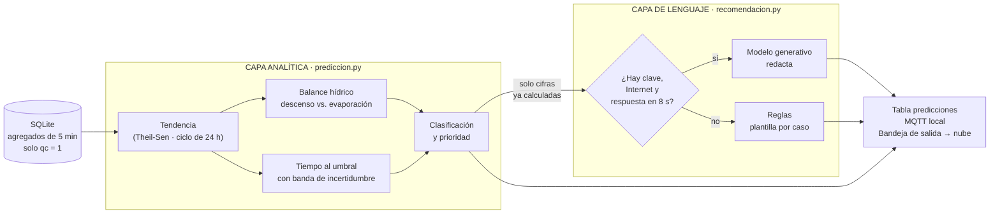
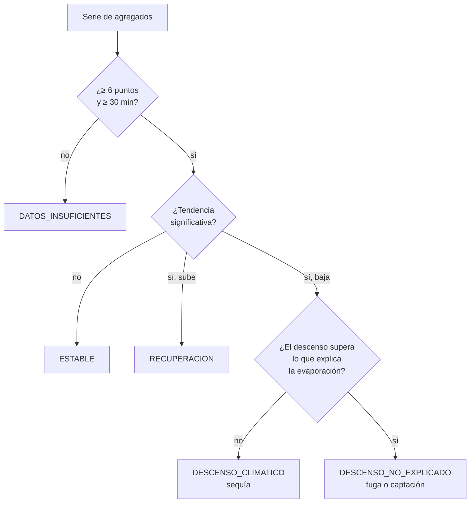
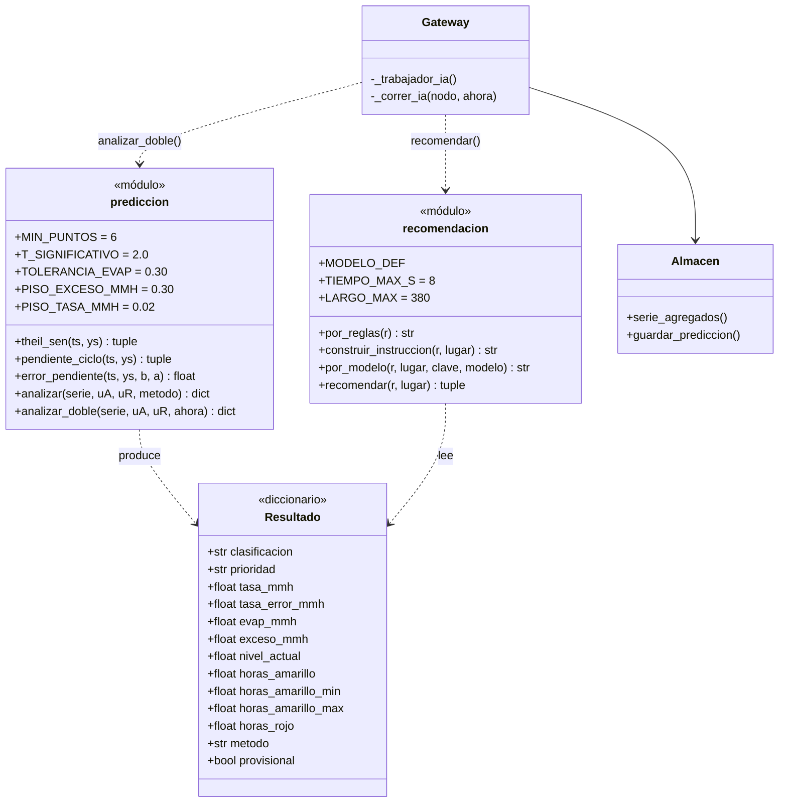
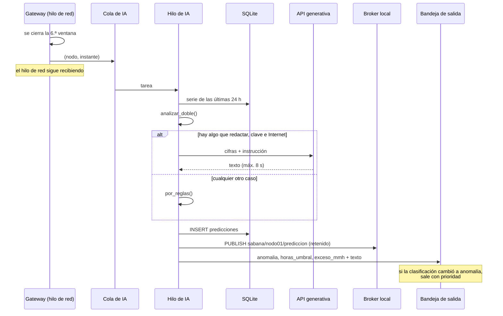

# C3.5 · Módulo de Inteligencia Artificial

## 5.1 Qué preguntas responde

Una alarma dice que el nivel **ya** está bajo. Quien administra un sistema de agua necesita tres respuestas más, y ninguna la puede dar el nodo, porque las tres exigen horas de historia:

| Pregunta de la autoridad | Función del módulo | Tipo (enunciado) |
|---|---|---|
| ¿Cuánto tiempo queda antes de la alerta? | Proyección del nivel al umbral | **Predicción** |
| ¿Baja por el clima o hay una pérdida? | Balance contra la evaporación | **Detección de anomalías** |
| ¿Qué hago? | Texto operativo según el caso | **Recomendación** |

El enunciado pide una de las tres. Se implementaron las tres porque en este problema son una sola cadena: la recomendación depende de la clasificación, y la clasificación depende de la tendencia.

---

## 5.2 Arquitectura: dos capas con oficios distintos



| | Capa analítica | Capa de lenguaje |
|---|---|---|
| Qué hace | **Calcula** | **Redacta** |
| Con qué | Estadística robusta, sin dependencias | Modelo generativo por API, con respaldo por reglas |
| Dónde corre | En la Raspberry | La llamada sale a Internet; el respaldo es local |
| ¿Necesita Internet? | **No** | Solo el camino generativo |
| ¿Es auditable? | Sí: mismas entradas, misma salida | El texto varía; las cifras no |
| Si falla | El Gateway sigue; se pierde una corrida | Se usa el texto por reglas |

---

## 5.3 Por qué un modelo generativo aquí, y por qué solo aquí

El enunciado recomienda explorar APIs generativas *"siempre que su integración sea técnicamente pertinente para el problema planteado y se justifique su uso"*. Esta es la justificación.

### Lo que NO se le encargó: la cuenta

Se podría enviar la serie de niveles a un modelo de lenguaje y preguntarle cuándo se acaba el agua. Se descartó:

| Razón | Detalle |
|---|---|
| **No es su oficio** | Ajustar una recta a 288 puntos es aritmética. Un modelo de lenguaje la aproxima; un estimador la calcula |
| **No es reproducible** | La misma serie puede dar respuestas distintas. Sobre ese número alguien va a decidir un racionamiento |
| **No es auditable** | Ante la pregunta "¿por qué 14 horas?", un estimador tiene respuesta: pendiente, error estándar, datos. Un modelo generativo no |
| **Exige Internet** | La predicción dejaría de existir justo cuando se cae la red, que es cuando un sistema de alerta más se necesita |
| **Cuesta por consulta** | 48 corridas al día, con la serie completa en cada una |

### Lo que SÍ se le encargó: las palabras

El resultado de la capa analítica es esto:

```json
{"clasificacion": "DESCENSO_NO_EXPLICADO", "tasa_mmh": -3.18, "evap_mmh": 0.18,
 "exceso_mmh": 3.0, "horas_amarillo": 9.0, "prioridad": "ALTA"}
```

Es correcto y un fontanero veredal no puede hacer nada con él. Convertirlo en *"el tanque está perdiendo agua más rápido de lo que explica el calor; a este ritmo quedan unas nueve horas; revisen hoy la tubería y las válvulas"* es una tarea de **lenguaje**: elegir palabras según quién lee, ordenar por urgencia, omitir lo que no importa. Para eso un modelo generativo sí es la herramienta adecuada.

### Las cuatro barreras que lo mantienen en su sitio

**1. Solo recibe cifras ya calculadas.** No recibe la serie. No puede "encontrar" una tendencia distinta de la que calculó el estimador.

**2. La instrucción le prohíbe calcular.** El texto que se le envía dice, entre otras reglas: *"Usa ÚNICAMENTE las cifras del análisis. No inventes ni recalcules números."* (Está completo en `ia/recomendacion.py`, función `construir_instruccion`.)

**3. Las cifras viajan aparte del texto.** Al tablero llegan `horas_umbral`, `exceso_mmh` y `anomalia` como variables numéricas, directamente desde la capa analítica. Si el texto dijera otra cosa, el número del tablero es el que vale.

**4. El texto no ejecuta nada.** Es una recomendación para una persona. Ninguna acción del sistema depende de él.

### Y un respaldo que no depende de nadie

Si no hay clave, si no hay Internet, si la API tarda más de 8 s o devuelve algo inesperado, `recomendar()` entrega el texto por reglas. **Nunca lanza una excepción y nunca deja al tablero sin recomendación.** El campo `origen` indica cuál de los dos caminos produjo el texto, y viaja a la nube con él.

Tampoco se gasta una llamada cuando no hay nada que redactar: con datos insuficientes o nivel estable se responde por reglas sin consultar la API.

> **Estado de la capa generativa.** El código está escrito y es el camino por defecto cuando existe la variable `GEMINI_API_KEY`. **No se ejecutó** en la validación de esta entrega: todas las recomendaciones que aparecen en [C3.8](C3.8-Resultados-y-analisis) son del respaldo por reglas. El nombre del modelo es configurable (`GEMINI_MODELO`), porque los modelos disponibles cambian. Su prueba es la H9 de [C3.7 §7.6](C3.7-Configuracion-experimental).

---

## 5.4 Capa analítica: el método

### Entrada

La serie de agregados de 5 minutos de la tabla `agregados`: marca de tiempo, nivel medio y evaporación media. **Solo ventanas con nivel válido**: la media de cada ventana se calculó únicamente con lecturas de bandera QARTOD 1, de modo que la IA nunca ve un dato que el control de calidad rechazó.

Los umbrales de alerta los informa el propio nodo en cada mensaje ([Contrato 2](C3.4-Diseno-modular)).

### Paso 1 · Tendencia

Dos estimadores, cada uno para una escala de tiempo.

**Ventana corta (3 h): Theil-Sen.** La pendiente es la **mediana** de las pendientes entre todos los pares de puntos [C3-11], [C3-12]. Se eligió sobre los mínimos cuadrados porque tolera hasta un 29 % de valores atípicos sin desviarse, y un ultrasónico de bajo costo los produce (ecos falsos, ondulación).

**Ventana larga (24 h): cambio neto en un ciclo completo.** La pendiente es la diferencia entre la mediana de la última hora y la mediana de la primera, dividida por el tiempo entre ambas.

La razón de tener un segundo estimador salió de la simulación y se cuenta completa en [C3.8 §8.9](C3.8-Resultados-y-analisis). En corto: la evaporación sigue al sol. De día el nivel baja rápido y de noche casi no baja. Sobre una curva así, la mediana de pendientes **depende de la hora a la que se mire**; el cambio neto a lo largo de un día completo, no.

Durante las primeras 23 horas no hay un ciclo completo. La ventana larga usa entonces Theil-Sen y el resultado se marca como **provisional**, y así lo dice la recomendación.

### Paso 2 · ¿Es una tendencia o es ruido?

Se calcula el error estándar de la pendiente. Solo se declara tendencia si:

- la pendiente supera **dos errores estándar** (≈ 95 % de confianza), **y**
- su magnitud supera **0,02 mm/h** (0,5 mm al día), por debajo de lo cual el sensor no distingue nada.

Si no, la clasificación es `ESTABLE`.

### Paso 3 · Balance hídrico

Es la misma idea del Challenge #2 —cruzar el nivel con el clima— llevada a la escala en la que funciona:

```
descenso observado   = −pendiente                       [mm/h]
pérdida esperada     = evaporación media ÷ 24           [mm/h]
exceso               = descenso observado − pérdida esperada
```

El descenso se declara **no explicado** si se cumplen las dos condiciones:

```
descenso > esperada × 1,30 + 2 × error de la pendiente
exceso   > 0,30 mm/h
```

| Parámetro | Valor | De dónde sale |
|---|---|---|
| Tolerancia de la evaporación | 30 % | La misma del firmware (Test 9 de QARTOD): incertidumbre de una estimación con viento asumido y radiación por *proxy* |
| Margen por la pendiente | 2 errores estándar | Consistencia con el paso 2 |
| Piso del exceso | 0,30 mm/h | ≈ 7 mm/día: por debajo, el exceso se confunde con el error de la propia evaporación estimada |

> **Por qué aquí sí funciona.** El firmware aplica esta misma comparación entre dos muestras separadas 2 s. En 2 s la evaporación baja el nivel una fracción de micra, y el ruido del sensor es del orden de décimas de milímetro: la señal está miles de veces por debajo del ruido. En tres horas la evaporación acumula décimas de milímetro y el promedio de 36 ventanas reduce el ruido. **La física es la misma; lo que cambia es que ahora hay memoria.** Es la justificación más directa de por qué hacía falta el Gateway.

### Paso 4 · Proyección al umbral

```
horas al umbral = (nivel actual suavizado − umbral) ÷ (−pendiente)
```

Se calcula para el umbral amarillo (Q80) y el rojo (Q90), y se acompaña de una **banda**: las horas que resultarían con la pendiente más rápida y más lenta compatibles con su error. No se proyecta más allá de 30 días.

### Paso 5 · Clasificación y prioridad



| Prioridad | Condición |
|---|---|
| `CRITICA` | Menos de 6 h al umbral **rojo** |
| `ALTA` | Menos de 6 h al umbral amarillo, **o** descenso no explicado |
| `MEDIA` | Menos de 72 h al umbral amarillo |
| `BAJA` | Lo demás |

### Paso 6 · Dos miradas a la vez

`analizar_doble()` corre el análisis sobre las dos ventanas y decide cuál manda:

| Ventana | Para qué sirve | Por qué esa longitud |
|---|---|---|
| **Larga · 24 h** | **Proyectar** cuándo se llega al umbral | Promedia un ciclo completo de día y noche |
| **Corta · 3 h** | **Detectar** una fuga que acaba de empezar | Una fuga reciente todavía no pesa en un promedio de 24 h |

La regla: **manda la larga, salvo que la corta vea un descenso no explicado.** Las dos clasificaciones quedan guardadas en el detalle de cada predicción, para poder revisar después por qué se decidió lo que se decidió.

---

## 5.5 Diagrama de clases



---

## 5.6 Integración con el resto del sistema



| Decisión de integración | Razón |
|---|---|
| Hilo propio | La llamada a la API puede tardar 8 s; el hilo de red no puede esperar tanto |
| Corre cada 6 ventanas (30 min) | Una tendencia de horas no cambia más rápido; ahorra consultas |
| Guiada por el tiempo del dato | Funciona igual en vivo y con historia reprocesada |
| Captura toda excepción | Una falla de la IA no detiene la recepción de datos |
| El resultado se publica también en el broker local | Un tablero en la WLAN puede mostrarlo sin Internet |
| El texto viaja en el *context* de la variable `anomalia` | Es el campo que la plataforma ofrece para datos no numéricos |

---

## 5.7 Qué le llega a la autoridad

Una recomendación por reglas para cada clasificación (son las que se ejecutaron):

| Clasificación | Texto que se entrega |
|---|---|
| `ESTABLE` | *Nivel estable, sin tendencia de descenso. No se requiere acción.* |
| `DESCENSO_CLIMATICO` | *El nivel baja 0.11 mm/h y la evaporación lo explica: es efecto del clima, no una pérdida. Al ritmo actual llegaría al umbral de alerta en unas 20 horas. Preparar medidas de ahorro y avisar a los usuarios del sistema con anticipación.* — (hora 36,0 del escenario) |
| `DESCENSO_NO_EXPLICADO` | *El nivel baja 3.2 mm/h y la evaporación solo explica 0.2 mm/h: hay una pérdida de 3.0 mm/h que el clima no justifica. A este ritmo llegaría al umbral de alerta en unas 8 horas. Inspeccionar HOY el punto: fugas en la estructura, válvulas abiertas o captaciones no autorizadas.* — (hora 12,0 del escenario) |
| `DATOS_INSUFICIENTES` | *Aún no hay historia suficiente para estimar una tendencia. Mantener la vigilancia con el valor actual y las alertas del nodo.* |

Los dos textos del medio son salidas reales del Gateway en los escenarios `sequia` y `fuga`. La diferencia entre ambos es exactamente la que motivó el módulo: **mismo síntoma —el nivel baja—, dos decisiones distintas.**

---

## 5.8 Limitaciones

Se declaran aquí y se desarrollan en [C3.9](C3.9-Autoevaluacion-del-protocolo).

- **La proyección es lineal.** Supone que mañana se parece a hoy. No sabe de pronósticos: si va a llover, no lo ve.
- **Depende de la evaporación que estima el nodo.** Si esa estimación está sesgada —y sin anemómetro lo está—, el balance hereda el sesgo. El 30 % de tolerancia lo absorbe solo en parte.
- **No distingue una fuga de una captación ni de un consumo legítimo.** Detecta que el agua baja más de lo que el clima explica. La causa la establece quien va al sitio.
- **El primer día es provisional.** Hasta completar 24 h, la proyección de largo plazo depende de la hora.
- **Los umbrales internos son de diseño, no de calibración.** Se fijaron por criterio físico y se comprobaron en simulación. Necesitan ajuste con datos de campo.
- **Se validó contra un modelo, no contra agua.** Ver [C3.7 §7.1](C3.7-Configuracion-experimental).
