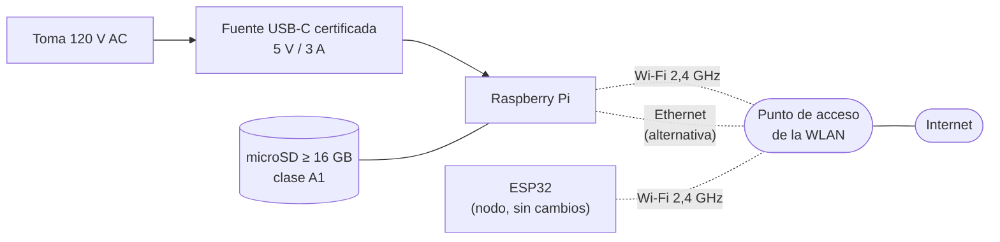
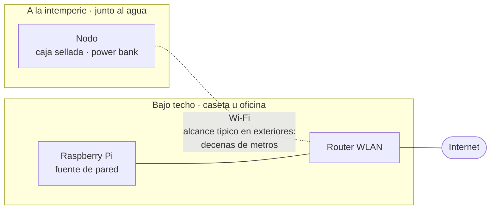

# C3.6 · Implementación

## 6.1 Qué se construyó

| Pieza | Carpeta del repositorio | Lenguaje | Líneas | Estado |
|---|---|---|---|---|
| Firmware con cliente MQTT | `firmware/EstacionHidroMQTT/` | C++ (Arduino / FreeRTOS) | 1 540 | Escrito; **pendiente de compilar y grabar** en el ESP32 |
| Gateway | `gateway/` | Python 3 | 998 | Escrito y **ejecutado** en simulación |
| Esquema de la base de datos | `gateway/esquema.sql` | SQL | 119 | Ejecutado |
| Configuración del broker | `gateway/mosquitto/` | — | — | Ejecutada sobre Mosquitto 2.0.18 |
| Módulo de IA | `ia/` | Python 3 | 407 | Capa analítica y respaldo por reglas ejecutados; capa generativa **sin ejecutar** |
| Nodo emulado | `simulador/` | Python 3 | 359 | Ejecutado |
| Banco de pruebas | `pruebas/` | Python 3 | 1 596 | Ejecutado |

> **Sobre el firmware.** El archivo `.ino` nuevo se revisó sintácticamente contra las firmas reales de la librería `PubSubClient`, pero **no se compiló con la cadena de herramientas del ESP32 ni se probó en la placa** antes de la entrega de este documento. Su comportamiento de red se validó de forma indirecta: el nodo emulado publica exactamente los mismos tópicos y cargas. Lo que eso deja sin cubrir está en [C3.9 §9.3](C3.9-Autoevaluacion-del-protocolo).

---

## 6.2 Hardware

### Esquemático

**El nodo no cambia.** El esquemático de interconexión del Challenge #2 sigue siendo el del sistema: está en [Anexos (Ch2) §B](15.-Anexos) y en [Arquitectura (Ch2) §3.2](3.-Arquitectura), con el mapa de pines y las dos notas de diseño no evidentes (LDR en ADC1; divisor obligatorio en el Echo).

El Gateway no agrega circuito:



| Elemento del Gateway | Especificación | Por qué |
|---|---|---|
| Raspberry Pi | ⚠️ *modelo: completar* | Disponible en el equipo |
| Fuente | 5 V / 3 A, certificada | Una fuente débil corrompe la tarjeta SD: es la falla más común de una Raspberry en campo |
| Tarjeta microSD | ≥ 16 GB, clase A1 | La base crece ~35 MB por semana de dato crudo; la retención la mantiene acotada |
| Red | Wi-Fi o Ethernet al mismo punto de acceso que el nodo | Ethernet es preferible si hay cable: elimina una fuente de fallas |
| GPIO | No se usa | El Gateway no toca hardware |

---

## 6.3 Firmware: qué cambió respecto al Challenge #2

Se partió de una copia de `EstacionHidro.ino`. Toda la lógica de medición, validación, fusión y alarma quedó **textualmente igual**. Los cambios, completos:

| # | Cambio | Dónde |
|---|---|---|
| 1 | Campo `seq` en la estructura `Muestra` | Consecutivo para detectar pérdidas |
| 2 | Segunda cola, `colaMqtt` (FIFO de 30) | La medición entrega cada muestra sin esperar |
| 3 | Tarea `tareaMqtt` en el core 1 | Conexión, publicación, comandos |
| 4 | `construirTelemetria()` | Arma el JSON; convierte `NaN` en `null` |
| 5 | `alLlegarComando()` | Ejecuta la orden y publica el `ack` |
| 6 | `aplicarSilencio()` | Función única para silenciar, usada por HTTP y por MQTT |
| 7 | Parámetros del broker en NVS y en `/api/calibrar` | Cambiar de broker sin recompilar |
| 8 | Tres campos en `/api/datos` | `mqtt`, `mqttPub`, `mqttDesc`: estado del enlace visible en el tablero local |

### La entrega de la muestra, sin esperar

```cpp
// tareaMedicion (core 0), al final de cada ciclo de 2 s
xQueueOverwrite(colaMuestras, &m);          // tablero local: último valor

// Nunca se espera: si la cola está llena (broker caído) se descarta
// la muestra MÁS ANTIGUA. La medición no se frena por la red.
if (xQueueSend(colaMqtt, &m, 0) != pdTRUE) {
  Muestra vieja;
  xQueueReceive(colaMqtt, &vieja, 0);
  xQueueSend(colaMqtt, &m, 0);
  mqttDescartes++;
}
```

### La tarea de transmisión

```cpp
void tareaMqtt(void *param) {
  mqtt.setBufferSize(MQTT_BUFFER);   // el valor por defecto (256) no alcanza
  mqtt.setKeepAlive(MQTT_KEEPALIVE_S);
  mqtt.setSocketTimeout(3);          // un broker mudo no cuelga la tarea más de 3 s
  mqtt.setCallback(alLlegarComando);

  for (;;) {
    if (!mqtt.connected()) {
      mqttConectado = false;
      if (tIntento == 0 || millis() - tIntento > MQTT_REINTENTO_MS) {
        tIntento = millis();
        if (conectarMqtt()) { alertaPublicada = -1; silencioPublicado = -1; }
      }
    } else {
      mqttConectado = true;
      mqtt.loop();                   // atiende comandos y keepalive

      Muestra m;                     // vacía lo que dejó la medición
      while (xQueueReceive(colaMqtt, &m, 0) == pdTRUE) {
        size_t n = construirTelemetria(buf, sizeof(buf), m);
        if (n < sizeof(buf) && mqtt.publish(topicoTelemetria, buf)) mqttPublicados++;
        else break;
      }
      // … anuncia la alerta solo cuando cambia, retenida …
    }
    vTaskDelay(pdMS_TO_TICKS(50));   // cede el núcleo a loop()
  }
}
```

### La conexión, con última voluntad

```cpp
// Si el nodo desaparece sin despedirse, el broker publica "offline" por él.
bool ok = mqtt.connect(NODO_ID, mqUser, mqPass,
                       topicoEstado, 1, true, "offline");
if (ok) {
  mqtt.publish(topicoEstado, "online", true);
  mqtt.subscribe(topicoCmd, 1);
}
```

### Parámetros nuevos de `config.h`

```cpp
#define MQTT_HOST_DEF     "192.168.1.50"   // IP de la Raspberry
#define MQTT_PUERTO_DEF   1883
#define MQTT_USER_DEF     "nodo01"         // usuario de mosquitto_passwd
#define MQTT_PASS_DEF     "cambiaesto-nodo"
#define NODO_ID           "nodo01"
#define MQTT_BASE         "sabana"

#define MQTT_BUFFER         512    // la telemetría ronda 260 bytes
#define MQTT_KEEPALIVE_S    15     // el broker declara muerto al nodo a los ~22 s
#define MQTT_REINTENTO_MS   5000
#define MQTT_COLA_MUESTRAS  30     // 30 x 2 s = 1 min de respaldo
```

**Librería adicional:** `PubSubClient` (Nick O'Leary). Las del Challenge #2 no cambian.

---

## 6.4 Gateway

### Estructura del programa

```
gateway/
├── gateway.py            Orquestador: recibe, reparte, encola
├── almacen.py            Única puerta a SQLite
├── procesamiento.py      Validación y agregación por ventanas
├── puente.py             Subida a la nube y bajada de comandos
├── esquema.sql           Las cinco tablas
├── gateway.ini.ejemplo   Plantilla de configuración
├── gateway.service       Unidad de systemd
├── mosquitto/
│   ├── estacion.conf     Broker: sin anónimos, con ACL, con persistencia
│   └── estacion.acl      Qué puede leer y escribir cada usuario
└── README.md             Puesta en marcha paso a paso
ia/
├── prediccion.py         Tendencia, tiempo al umbral, balance hídrico
└── recomendacion.py      Texto: modelo generativo con respaldo por reglas
```

### Lo esencial del recorrido de un mensaje

```python
def _telemetria(self, nodo, texto):
    carga = json.loads(texto)                       # ¿es JSON?
    ok, motivo = validar(carga)                     # ¿forma, tipos, rangos?
    if not ok:
        return self._rechazar(nodo, motivo)         # a la bitácora, y sigue

    lectura = {..., "ts": float(carga.get("ts", ahora)), "ts_rx": ahora, ...}
    self.almacen.guardar_lectura(lectura)           # 1) primero a disco

    agregado, reinicio = self.agregador.agregar(lectura)   # 2) luego se procesa
    if agregado:
        self._ventana_cerrada(agregado)             # 3) y se encola para la nube
```

### La bandeja de salida

```python
def _vaciar(self):                                  # hilo "puente"
    while not self._parar.is_set():
        if not self.conectado.is_set():             # sin nube: esperar
            self._parar.wait(0.5); continue
        fila = self.almacen.siguiente_salida()      # alertas primero, luego por orden
        if fila is None:
            self._hay_trabajo.wait(2.0); continue
        info = self.cliente.publish(fila["topico"], fila["carga"], qos=1)
        info.wait_for_publish(timeout=10)
        if info.is_published():                     # llegó el PUBACK
            self.almacen.marcar_enviado(fila["id"])
            self._parar.wait(self.intervalo_s)      # 1 mensaje por segundo
        # si no llegó, la fila sigue pendiente y se reintenta
```

### Puesta en marcha

La guía completa, con una verificación al final de cada paso y una tabla de fallas frecuentes, está en [`gateway/README.md`](https://github.com/tomasarro13/estacion-hidrometeorologica-sabana-centro/blob/main/gateway/README.md). En resumen:

| Paso | Qué se hace | Cómo se verifica |
|---|---|---|
| 1 | `apt install mosquitto mosquitto-clients python3-paho-mqtt sqlite3` | `import paho.mqtt` no falla |
| 2 | Copiar `estacion.conf` y `estacion.acl`; crear tres usuarios con `mosquitto_passwd` | Publicar sin credenciales **falla**; con credenciales, llega |
| 3 | Ubidots: dispositivo `estacion-sabana`, variable `silenciar`, tablero, eventos | El dispositivo aparece |
| 4 | `gateway.ini` y `secretos.env` (permisos 640) | "Conectado al broker local" y "Nube conectada" |
| 5 | Correr el **simulador** contra la Raspberry | Filas en SQLite y variables con datos en Ubidots |
| 6 | Grabar el firmware con la IP de la Raspberry | Una línea de telemetría cada 2 s en `mosquitto_sub` |
| 7 | Instalar la unidad de `systemd` | Tras `reboot`, el servicio está `active` sin intervención |
| 8 | Interruptor `silenciar` en Ubidots | El zumbador calla; el LED rojo sigue encendido |

El paso 5 es deliberado: **se prueba la Raspberry completa antes de conectar el ESP32.** Si algo falla, ya se sabe de qué lado está.

---

## 6.5 Plataforma en la nube

### Dispositivo y variables

Un dispositivo, etiqueta `estacion-sabana`. Las variables de datos las crea la plataforma al recibir el primer mensaje; la de comando (`silenciar`) se crea a mano. La lista completa está en el [Contrato 4](C3.4-Diseno-modular).

### Tablero global

| Widget | Variable | Requisito del enunciado que cubre |
|---|---|---|
| Tanque / indicador | `nivel` | Valor actual |
| Gráfica de líneas | `nivel`, `evap` | Histórico reciente |
| Indicador de estado | `alerta` (0–3) | Alertas |
| Métrica | `horas_umbral` | Predicción (IA) |
| Indicador | `anomalia` | Detección de anomalías (IA) |
| Tabla de la variable | `anomalia` → *context* | Recomendación (IA) |
| **Interruptor** | `silenciar` | **Desactivar alarmas físicas** |
| Indicador | `en_linea` | Presencia del nodo |

### Eventos y notificaciones

| Evento | Condición | Acción |
|---|---|---|
| Alerta roja | `alerta` ≥ 2 | Correo o mensajería al responsable |
| Descenso no explicado | `anomalia` = 1 | Correo: posible fuga o captación |
| Nodo fuera de línea | `en_linea` = 0 durante 5 min | Correo |

Los tres eventos **reaccionan** a variables que ya traen la decisión tomada. La plataforma no recalcula umbrales: si lo hiciera, habría dos lógicas de alarma que podrían no coincidir.

### Acceso

El tablero no tiene enlace público. Se entra con la sesión de la plataforma.

> ⚠️ **Pendiente a la fecha de entrega.** La cuenta, el tablero y los eventos se configuran junto con la integración física. Esta sección documenta el **diseño**; no hay capturas porque no se muestran pantallas que aún no existen. Se presentan en la sustentación.

---

## 6.6 Despliegue



| Consideración | Decisión |
|---|---|
| Dónde va el Gateway | Bajo techo, con energía de pared. No necesita caja IP65 |
| Distancia nodo–punto de acceso | Dentro del alcance Wi-Fi. Si no alcanza: repetidor, o migrar el tramo a LoRa (diseñado en la Actividad 2.3) |
| Corte de energía en el Gateway | El nodo sigue alarmando. Al volver, `systemd` levanta todo solo |
| Corte de Internet | El Gateway acumula y reenvía |
| Reloj de la Raspberry | Se sincroniza por NTP cuando hay Internet. Sin reloj de tiempo real, un arranque sin Internet fecharía mal los datos: se recomienda un módulo RTC para despliegue real ([C3.11](C3.11-Conclusiones-retos-y-trabajo-futuro)) |
