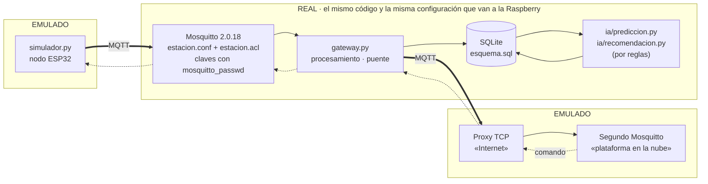

# C3.7 · Configuración experimental

## 7.1 Qué tipo de validación es esta

> **Validación por simulación** (*software-in-the-loop*). No es una medición sobre el prototipo físico.

El enunciado define el resultado de aprendizaje como *"validando el diseño a nivel de simulación y/o prototipado"*. A la fecha de entrega de esta documentación la integración sobre la Raspberry Pi no estaba cerrada, de modo que el equipo validó a nivel de simulación y lo declara así.

La regla que se siguió para que esa simulación valga algo: **ejecutar el software real, y emular solo lo que no se tenía.**



| Componente | En la prueba | Por qué vale |
|---|---|---|
| Broker local | **Real.** Mosquitto 2.0.18 con los archivos `estacion.conf` y `estacion.acl` del repositorio; solo cambian el puerto y las rutas | Es el mismo binario y la misma configuración |
| Gateway | **Real.** `gateway.py` lanzado como proceso aparte, con su archivo `.ini` | No sabe que el nodo es simulado |
| Base de datos | **Real.** SQLite con `esquema.sql` | Las cifras de integridad se leen de ella |
| Módulo de IA | **Real** en su capa analítica y en el respaldo por reglas | Es el código que corre en la Raspberry |
| Nodo ESP32 | **Emulado** por `simulador.py` | Mismos tópicos, mismo JSON, mismos comandos. La lógica de alarma y la fórmula de evaporación se portaron línea a línea del firmware |
| Plataforma en la nube | **Emulada** por un segundo broker | Recibe los mismos tópicos y cargas que Ubidots (`/v1.6/devices/…`) |
| Enlace a Internet | **Emulado** por un proxy TCP que se puede cortar | Permite provocar una caída de Internet sin apagar la «nube» |

### Lo que la simulación NO es

Conviene decirlo antes de mostrar un solo número:

- **No hay ESP32.** No se probó el firmware nuevo en la placa: ni su compilación, ni el uso de memoria, ni la convivencia de `tareaMqtt` con el servidor web, ni el Wi-Fi.
- **No hay Raspberry Pi.** Las pruebas corrieron en un computador x86-64. Los tiempos y el caudal de mensajes **no son los de una Raspberry**.
- **No hay red.** Todo corre por la interfaz de lazo local de una sola máquina. No hay latencia de Wi-Fi, ni pérdida de paquetes, ni Internet.
- **No hay Ubidots.** El tablero, los eventos y las notificaciones no se ejercitaron.
- **No hay agua.** El tanque y el clima son un modelo matemático.
- **No se llamó a ningún modelo generativo.** La recomendación que aparece en los resultados es la del respaldo por reglas.

Cada una de esas ausencias tiene su prueba pendiente en [§7.6](#76-pruebas-sobre-el-prototipo-físico-pendientes).

---

## 7.2 Entorno de ejecución

| Elemento | Valor |
|---|---|
| Fecha de la corrida | 2026-11-16 16:34:55 (UTC) |
| Sistema | Linux 6.18.44-fc-v470 (x86_64) |
| Python | 3.13.18 |
| SQLite | 3.53.1 |
| Broker | Eclipse Mosquitto 2.0.18 |
| Cliente MQTT | paho-mqtt 2.2.0 (se repitió una prueba de humo con 1.6.1, la versión de los repositorios de Raspberry Pi OS) |
| Ventana de agregación | 300 s |
| Corrida del módulo de IA | Cada 6 ventanas (30 min de tiempo simulado) |
| Capa generativa de la IA | Desactivada (`generativa = no`, sin clave) |

### Cómo se repite

```bash
sudo apt install mosquitto python3-paho-mqtt        # o pip install paho-mqtt
python3 pruebas/ejecutar_pruebas.py
```

El programa levanta los dos brokers en puertos altos, lanza el Gateway, corre las nueve pruebas y escribe todo en `datos/ch3-simulacion/`. Toma unos diez minutos. **Ninguna cifra de la Wiki está escrita a mano**: todas salen de `resultados.json`. La semilla del generador aleatorio es fija, así que los escenarios son reproducibles; los tiempos de reloj varían de una máquina a otra.

---

## 7.3 El modelo del nodo simulado

### Lo que se portó del firmware (y por tanto se prueba de verdad)

| Del firmware | En el simulador |
|---|---|
| Tópicos, QoS, retención, última voluntad | Idénticos |
| Carga JSON de la telemetría | Idéntica, más el campo `ts` |
| `evaluarAlerta()` — corroboración, persistencia, histéresis | Portada línea a línea, con las constantes de `config.h` |
| `actualizarAlarma()` — expiración del silencio | Portada |
| `alLlegarComando()` — validación de la orden y `ack` | Portada |
| `evapPenman()`, `radiacionMJ()`, `caudalLmin()` | Portadas |
| Pruebas QARTOD de rango, tasa de cambio y coherencia | Portadas |

### Lo que es modelo (y por tanto no es una medición)

| Elemento | Modelo | Fundamento |
|---|---|---|
| Temperatura | Sinusoide diaria, 8 a 20 °C, máximo a las 14 h | Orden de magnitud del ciclo diario en la Sabana de Bogotá |
| Humedad relativa | 85 % de noche, hasta 53 % al mediodía | Ídem |
| Presión | 752 hPa ± 1,2 | Altitud de ~2 560 m |
| Luz (LDR) | 0 de noche; media sinusoide de 6 a 18 h, pico 82 % | — |
| Nivel del tanque | Baja por la evaporación que el propio nodo estima y, si aplica, por una fuga constante | Balance de masa |
| Ruido del nivel | Gaussiano, **σ = 0,02 cm** | Dispersión medida por el equipo con el sistema en operación (`datos/repetibilidad-operacion.csv`, Challenge #2) |
| Ruido del nivel, caso severo | Gaussiano, **σ = 0,176 cm** | Desviación del valor consolidado estimada en [Resultados (Ch2) §8.2](8.-Resultados-y-analisis) a partir de los disparos en reposo |

> **Dos supuestos que favorecen al sistema, declarados.** Primero, el tanque simulado pierde exactamente la evaporación que el nodo calcula: en la realidad la estimación tiene error (viento asumido, radiación por *proxy*) y por eso el módulo de IA le concede un 30 % de tolerancia. Segundo, el clima simulado es suave y periódico: no hay nubes que pasen, ni lluvia, ni viento.

### El campo `ts`

El ESP32 real no fecha sus mensajes: lo hace el Gateway al recibir. El simulador agrega un campo `ts` con el tiempo simulado, y el Gateway lo respeta si viene. Es lo que permite **comprimir tres días de operación en minuto y medio**. Es la única diferencia de protocolo con el nodo real y solo afecta de dónde sale la marca de tiempo.

### Escenarios

| Escenario | Duración simulada | Nivel inicial | Qué pasa | Para qué sirve |
|---|---|---|---|---|
| `estable` | 24 h | 20,0 cm | Aporte y pérdidas en equilibrio | Falsos positivos de la IA; integridad |
| `sequia` | 72 h | 12,6 cm | Sin aporte: baja solo por evaporación hasta cruzar el umbral de 12 cm | Predicción del tiempo al umbral |
| `fuga` | 30 h | 16,0 cm | Evaporación + **fuga de 3 mm/h desde la hora 8** | Detección de anomalía y su demora |
| `falla` | 2 h | 20,0 cm | El ultrasónico pierde el eco 10 min | Datos faltantes de extremo a extremo |
| `critico` | 1 h | 7,0 cm | Bajo el umbral rojo: alarma sonando | Comando de silencio |

Los tres primeros se corrieron dos veces: con el ruido de operación y con el ruido severo.

---

## 7.4 Protocolo de pruebas en simulación

| # | Prueba | Requisito del enunciado | Procedimiento | Criterio de aceptación |
|---|---|---|---|---|
| **S1** | Integridad de extremo a extremo | Transmisión MQTT, almacenamiento, procesamiento, envío a la plataforma | Seis corridas de 24 a 72 h simuladas. Se cuentan mensajes publicados, filas en SQLite, agregados y puntos recibidos en la nube | Cero pérdidas en cada tramo; ≤ 4 000 datos/día hacia la nube |
| **S2** | Control de acceso del broker | Acceso restringido | Diez intentos: sin credenciales, clave errada, usuario inexistente, y cada usuario intentando leer o escribir fuera de su rama | Los diez con el resultado esperado |
| **S3** | Validación de mensajes | Procesamiento local | Diez mensajes malformados intercalados con tres válidos | Los diez rechazados y registrados; los tres guardados; el Gateway sigue operando |
| **S4** | Latencia por tramo | Tiempo real | 300 muestras y 20 órdenes con marca de tiempo en cada punto | Se reporta; es cota inferior (sin red) |
| **S5** | Caída de Internet | Almacenamiento local antes de transmitir | 4 h con enlace, 8 h con el enlace cortado, restablecer, 2 h más | Nada llega durante el corte; al volver, cero pérdidas, cero duplicados, orden cronológico |
| **S6** | Comando de silencio y salvaguardas | Desactivar alarmas físicas desde el tablero | Con la alarma sonando: silenciar, reactivar, orden vieja, orden inválida, silenciar y esperar 15 min | Diez comprobaciones con el resultado esperado |
| **S7** | Caída del nodo | Notificación ante eventualidades | Se congela el proceso del nodo (sin cerrar el socket) y luego se lo reinicia | El Gateway registra `offline` en ~1,5 × *keepalive*; detecta el reinicio por el consecutivo |
| **S8** | Reinicio del Gateway | Robustez | Con el nodo publicando, se apaga el Gateway 2 s y se lo vuelve a levantar | Lo no recibido queda **contado**, exactamente |
| **S9** | Módulo de IA | Predicción, detección de anomalías, recomendación | Línea de tiempo de la IA en cada escenario contra la verdad del modelo | Sin falsas anomalías en `estable` y `sequia`; fuga detectada; error de predicción reportado |

---

## 7.5 Métricas

| Métrica | Definición | Fuente |
|---|---|---|
| Pérdida nodo → SQLite | Mensajes publicados − filas en `lecturas` | Contador del simulador y `SELECT COUNT(*)` |
| Pérdida SQLite → nube | Agregados en `agregados` − marcas de tiempo distintas recibidas en la nube | Observador suscrito al broker «nube» |
| Duplicados en la nube | Puntos recibidos − marcas de tiempo distintas | Ídem |
| Datos por día | Variables recibidas en la nube ÷ días simulados | Ídem |
| Latencia nodo → SQLite | `ts_rx` del Gateway − instante de publicación | Columna `ts_rx` y reloj del simulador |
| Latencia de la orden | Publicación en la «nube» → llegada del `ack` al nodo | Reloj del banco |
| Demora de detección | Primera clasificación `DESCENSO_NO_EXPLICADO` − inicio real de la fuga | Tabla `predicciones` y verdad del modelo |
| Error de predicción | (Instante de la predicción + horas predichas) − instante real del cruce | Ídem |
| Falsa anomalía | `DESCENSO_NO_EXPLICADO` sin fuga en el modelo | Ídem |

---

## 7.6 Pruebas sobre el prototipo físico (pendientes)

Protocolo definido; ejecución posterior a la entrega de esta documentación. Se presentan con su criterio de aceptación y **sin resultados**.

| # | Prueba | Qué valida que la simulación no puede | Criterio de aceptación |
|---|---|---|---|
| **H1** | Compilación y arranque del firmware | Que `EstacionHidroMQTT.ino` compila para ESP32 y arranca con las tres tareas | Sin errores; `[MQTT] Conectado` en el monitor serie |
| **H2** | Cadena completa con hardware | Dato real del HC-SR04 visible en Ubidots | Una línea cada 2 s en `mosquitto_sub`; variables actualizándose en la plataforma |
| **H3** | Coexistencia de tareas | Que `tareaMqtt` no degrada el período de 2 s ni el tablero local | Período de medición 2,00 s ± 0,05 con MQTT activo; tablero local respondiendo |
| **H4** | Broker caído, visto desde el nodo | Que el nodo sigue midiendo, alarmando y sirviendo su tablero | Con Mosquitto detenido: alarma y tablero local operan; `mqttDesc` crece |
| **H5** | Caída de Internet real | Reenvío contra Ubidots con el límite de 1 mensaje/s | Tramo sin huecos en la gráfica de la plataforma |
| **H6** | Silencio desde Ubidots | Latencia real de la orden por Internet y Wi-Fi | El zumbador calla en < 5 s; el LED rojo sigue encendido |
| **H7** | Notificación fuera de la WLAN | Eventos de la plataforma | Mensaje recibido en un teléfono con datos móviles |
| **H8** | Acceso denegado en los dos tableros | Barreras reales | Tablero local pide credenciales; tablero global pide sesión |
| **H9** | Capa generativa de la IA | Llamada real a la API y calidad del texto | El texto usa solo las cifras entregadas; con la clave retirada, sale el de reglas |
| **H10** | IA sobre agua real | Detección con el sensor y el ruido reales | Con el desagüe abierto: `anomalia = 1` en menos de una hora |
| **H11** | Arranque autónomo del Gateway | `systemd` | Tras `reboot`, servicio `active` sin intervención |
| **H12** | Carga en la Raspberry Pi | Uso de CPU y memoria reales | Se reporta |
